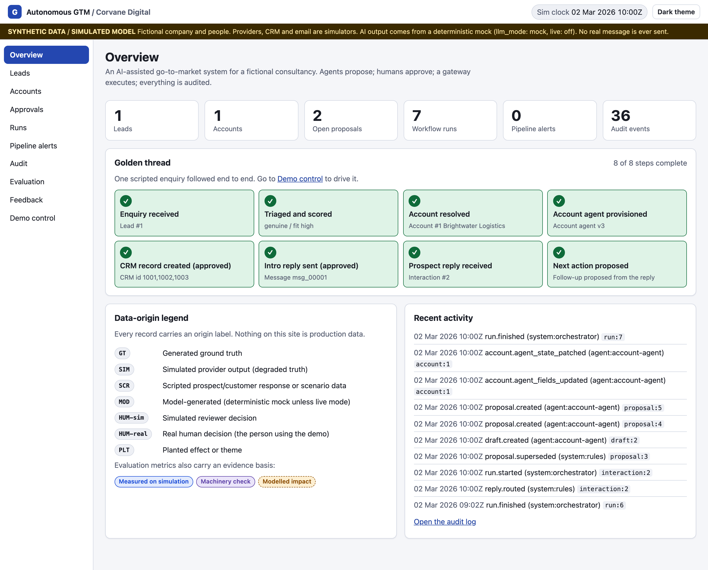
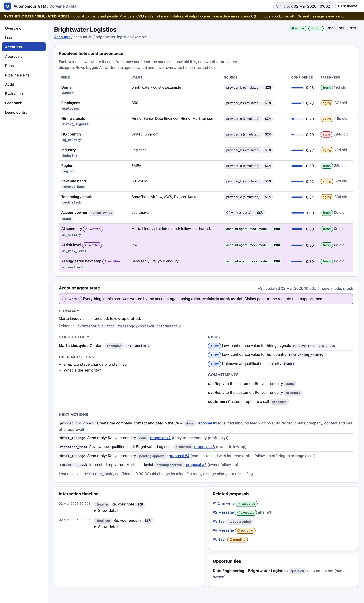
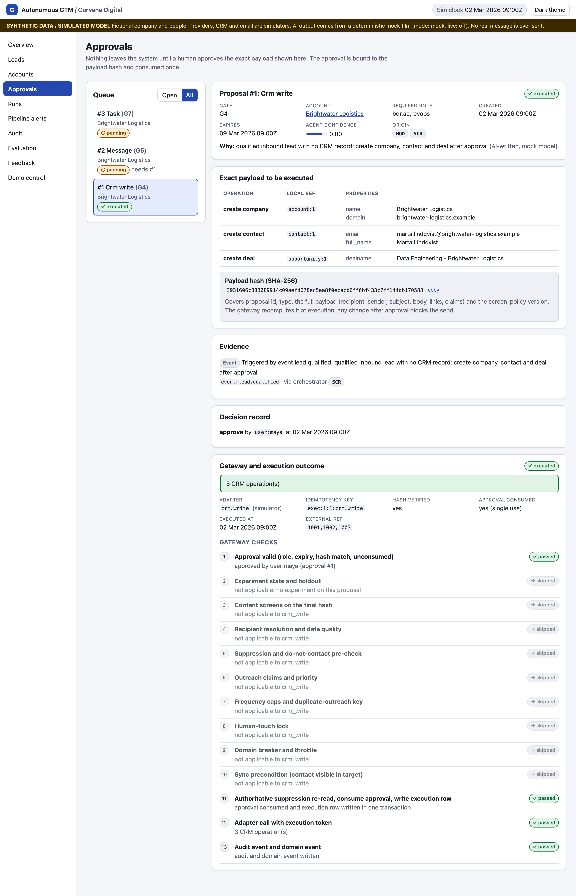
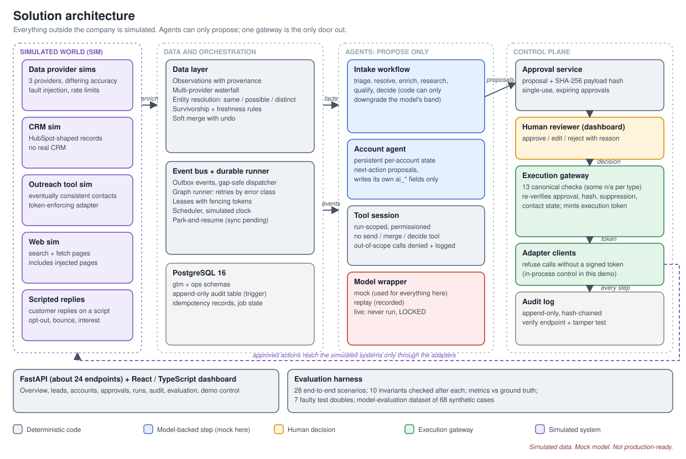
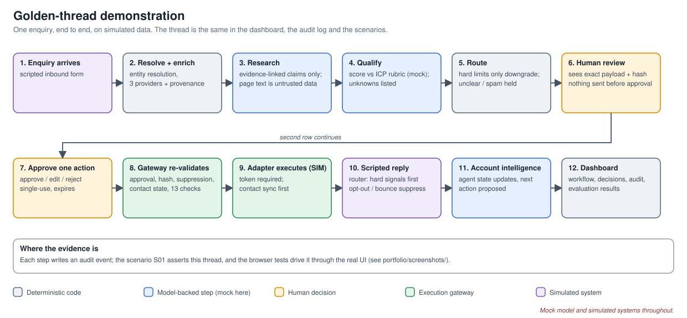
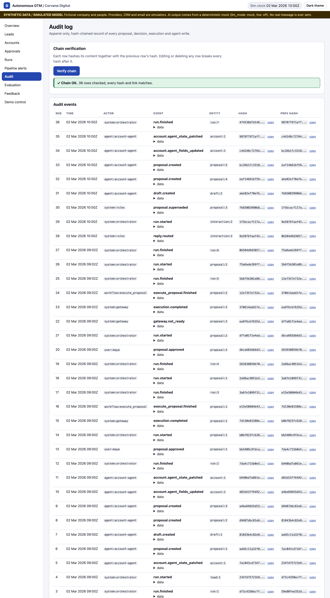

# Autonomous GTM

**What if a consultancy's whole path from "someone filled in our contact form" to "we are talking to the right person" worked as one connected process, with software doing the preparation and people keeping every decision that matters?**

Autonomous GTM is a working case study of that idea, built for a fictional technology consultancy, Corvane Digital. It runs end to end on synthetic data and simulated systems.

> **Read this first.** Everything here is a demonstration. The company, people, CRM, outreach tool, data providers and customer replies are simulated, and the language model is a deterministic stand-in. Real model performance is untested, no live model call has ever been made, and no business outcome (revenue, conversion, productivity) has been measured. There is no production CRM integration. The benefits below are what the design is *intended* to deliver, not results.

---

## The problem

Picture a growing consultancy. Enquiries arrive from companies that might become clients, and each one starts the same chain of small jobs. Someone works out which company it is, looks up its size, region and contacts, decides whether it fits the kind of client the firm serves, writes a careful reply, updates the CRM and remembers to follow up.

None of these jobs is hard. The trouble is the seams between them:

- **Information is scattered** across a mailbox, data providers, the CRM and people's heads. Nobody sees the whole account.
- **Work is repeated.** Research is redone because the last person's notes were not where expected, and facts retyped between systems drift apart.
- **Judgement is uneven.** Two people assess the same enquiry differently and cannot easily explain why.
- **Handoffs drop things.** A reply waits for a CRM record that does not exist yet, and a follow-up depends on someone noticing.

Automating each step in isolation leaves the seams in place, only faster. Automation without enough oversight can be worse than slow: it can send the wrong message to the wrong address, overwrite what a salesperson knows, follow instructions hidden inside an enquiry, or apply Monday's approval to Tuesday's changed email address. The real difficulty is not doing the tasks. It is doing them as one process that stays trustworthy.

## The opportunity

Treat go-to-market work as a connected system: one that keeps a shared picture of each account, notices when something happens, prepares the next sensible step with its evidence attached, lets a person decide, and records why. The value would be practical rather than dramatic: less repeated research, more consistent assessment, fewer dropped handoffs, and a clear answer when someone asks "why did we send that?".

## The idea

**Software agents prepare the work. People make the important decisions. A controlled execution step connects approved decisions to the outside world.**

- **Agents prepare.** They identify the company, gather facts, research the account, assess fit and recommend a next action. They can only *propose*; they cannot send, edit the CRM or approve anything.
- **People decide.** A reviewer sees the exact message or CRM change and approves, edits or rejects it.
- **A gateway executes.** Only an approved proposal can cause an action, and only through one checkpoint that re-validates everything first.

## One enquiry, start to finish



The demo follows a single enquiry through Corvane Digital, on simulated data.

1. **It arrives.** Marta Lindqvist, at Brightwater Logistics, writes that her firm is consolidating telematics and warehouse data and wants to pilot software agents for delivery exceptions.
2. **The system identifies her.** It matches the company and contact to what it already knows and reports its confidence: same, possible or distinct. Errors here cause duplicates and wrong-account updates.
3. **It gathers facts.** Simulated providers are consulted. Each field keeps its source, confidence and age, and disagreements stay visible.
4. **It researches the account.** Every claim cites a source or is marked unknown. Outside text, including the enquiry, is read as material, never obeyed as instructions.



5. **It assesses fit** against the ideal customer profile. Missing or low-confidence facts prompt a human to verify them instead of silently rejecting the lead; spam and suspected manipulation are held for a person.
6. **It proposes.** The account agent suggests creating the CRM account and sending an introductory reply. These are proposals only.
7. **A person reviews.** The reviewer sees the exact payload and its SHA-256 fingerprint. In the demo, editing the reply to quote a price is blocked, because commitments are a human decision.



8. **The gateway executes carefully.** It re-checks the approval, fingerprint, recipient and opt-out list just before acting. The reply waits for the CRM record, and is parked until the simulated outreach tool has synced the contact.
9. **The customer answers** ("Thanks, this is timely..."). Opt-outs and bounces are handled first by fixed rules; otherwise the account's shared context is updated.
10. **A follow-up is proposed**, and waits for a person again. Every step is in a tamper-evident audit log.

One connected process: information gathered once, carried forward, acted on with approval, and recorded.

## Why this could matter

Intended benefits of the design. None has been measured.

| Business challenge | How the system addresses it | Intended value |
|---|---|---|
| Fragmented customer information | Entity resolution and multi-provider enrichment, with source and confidence per field | A more complete, trustworthy account picture |
| Repetitive manual research | Shared account memory and evidence-linked research | Less duplicated research effort |
| Inconsistent qualification | A defined ICP rubric and one qualification workflow | More consistent, explainable assessment |
| Manual handoffs | Event-driven orchestration that waits, retries and resumes | Better coordination between steps |
| Uncontrolled automation | Proposals only, human approval, one execution gateway | Greater accountability and control |
| Limited visibility | Hash-chained audit log and an evaluation harness | Traceability, and a way to test the claims |

## What makes the approach different

- **Connected workflows, with shared account context,** not isolated automations or agents with private notes. Each step passes its results and evidence on.
- **Evidence-backed recommendations,** not unsupported claims. Missing information raises a question rather than a guess.
- **Human approval,** not unrestricted autonomy. Approval is bound to a fingerprint of the exact payload, so an approved message cannot change afterwards.
- **Traceable actions,** not invisible automation. The audit log is append-only, so history cannot quietly be rewritten.
- **Evaluation,** not assumption. Scenarios and invariants test whether the controls hold, including injected faults and hostile inputs.

## How it is built



Agents write proposals, a person decides, and the execution gateway is the single route to anything outside the system. Workflow state, events and the audit log share one PostgreSQL database, so a step, its event and its audit record are saved together or not at all.



The stack is Python 3.12, FastAPI and PostgreSQL 16 on the back end, with React, TypeScript and Vite on the front end. Components, rationale and rejected alternatives are in [`docs/technology-decisions.md`](docs/technology-decisions.md), [`docs/solution-architecture.md`](docs/solution-architecture.md) and [`DECISIONS.md`](DECISIONS.md).

## See it working

A 105-second recording of the real interface against the real back end: **[golden-thread.mp4](portfolio/demo/golden-thread.mp4)** ([GIF version](portfolio/demo/golden-thread.gif)).

Watch for: fields showing their source and age; the exact payload and hash on the approval screen; the price edit being blocked; time advancing an hour to release the parked reply; the customer reply and follow-up proposal; and *Verify chain* on the audit page. A click-by-click version is in [`portfolio/DEMO_SCRIPT.md`](portfolio/DEMO_SCRIPT.md), and more screens are in [`portfolio/screenshots/`](portfolio/screenshots/MANIFEST.md).



## Evidence, and what it does not show

| | Status |
|---|---|
| **Implemented** | The workflow above, approval and execution controls, audit log, simulated world, dashboard, evaluation harness |
| **Technically tested** | 416 back-end tests pass. 28 end-to-end scenarios pass, with 10 invariants checked after each (for example, no action runs without a matching approval) |
| **Simulated** | Companies, people, data providers, CRM, outreach tool and customer replies (scripted) |
| **Evaluated with a stand-in** | A 68-case dataset scored against a deterministic mock model, which routes 26 of 27 qualification cases correctly. Seven deliberately faulty test models confirm the harness catches bad behaviour |
| **Not measured** | Real language-model quality, and any effect on conversion, revenue or productivity |
| **Incomplete** | 8 more scenarios are designed but not runnable; 41 of 151 requirements have a runnable scenario |

Important limits:

- The mock's perfect scores on injection resistance, claim support and consistency hold by construction. They are not findings. It also misses 3 of the 10 messages that should be held for review.
- A zero-cost lock keeps live model use disabled ([`model_eval/ZERO_COST_LOCK.md`](model_eval/ZERO_COST_LOCK.md)). It is a policy lock, not a technical impossibility.
- The adapter-token check is an in-process control in a single-process demo with one fixed reviewer and no authentication. It illustrates the design; it is not a security boundary.
- The 0.6 confidence threshold is a configurable business setting, not a validated value. Dataset labels were partly reviewed by an automated reviewer, not a person, and five contested cases remain open.
- Documented policy gaps were not built: promotional versus service messages, support routing, "not now" timing, meeting priority and a verification queue ([`model_eval/10_business_policy.md`](model_eval/10_business_policy.md)).

Test history is in [`TEST_RESULTS.md`](TEST_RESULTS.md), and the evaluation work in [`model_eval/`](model_eval/README.md).

## The bigger idea

It is easy to read this project as a collection of automated tasks: look up a company, score a lead, draft an email. Those parts are the least interesting. A system could do each well and still make the business worse, if nobody could tell what it knew, why it acted, or who had agreed to it.

The harder design problem is the connective tissue: where information lives, how a decision is made, what is allowed to happen as a result, and how anyone can later reconstruct it. When those four work together, automation stops being a set of tools to watch and becomes part of how the business operates.

## Run it yourself

**Prerequisites:** Python 3.12, Node 20+, Docker. No API keys or accounts are needed.

```bash
./scripts/db_up.sh                                    # PostgreSQL 16 in Docker on 127.0.0.1:5433
python3.12 -m venv .venv && source .venv/bin/activate
pip install -e "backend[dev]"
python -m gtm.cli serve                               # API + simulators on http://127.0.0.1:8765 (resets the demo database)

cd frontend && npm install                            # second terminal
VITE_API_MODE=http npm run dev                        # UI on http://localhost:5173 (or `npm run dev` for mock mode, no backend)
```

Open **Demo control** and follow the demo script. Tests: `cd backend && python -m pytest tests -q` (needs the Docker PostgreSQL), `python -m gtm.eval.runner --harness gtm.harness:Harness` for the scenarios, and `cd ../frontend && npm test`.

## Go deeper

[`docs/case-study.md`](docs/case-study.md) (full narrative and a five-minute [executive summary](docs/case-study.md#executive-summary-five-minute-read)) · [`docs/`](docs/README.md) (requirements, architecture, data model, oversight) · [`model_eval/`](model_eval/README.md) (evaluation datasets and results) · [`IMPLEMENTATION_STATUS.md`](IMPLEMENTATION_STATUS.md)

The project does not describe any real company's internal systems. Two industry sources informed the design and are cited only as far as their summaries support.

Released under the [MIT Licence](LICENSE).
