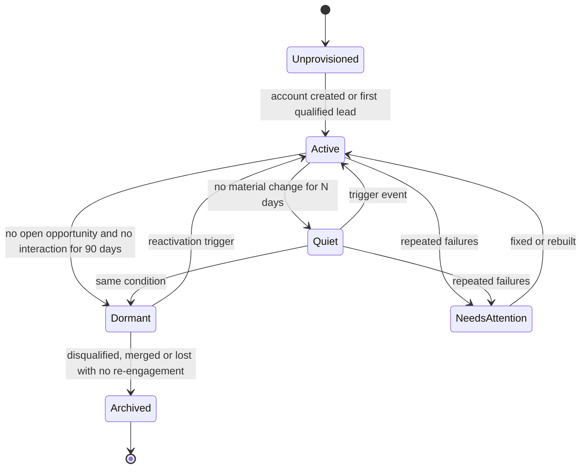
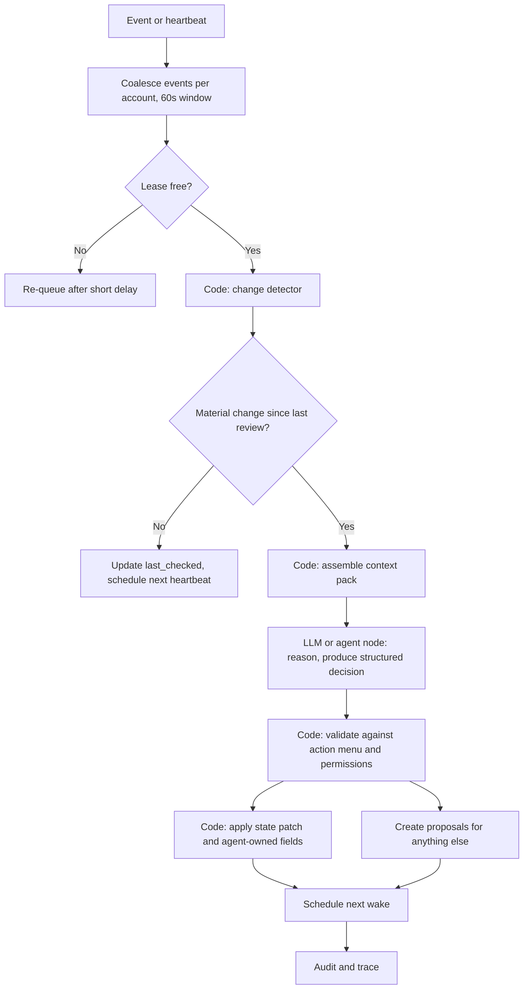

# Account intelligence and persistent account agents

**New file (Phase 3).** Design only, **[P]**. The idea of persistent account-level agents woken by triggers or heartbeats, keeping agent-specific state, and the separation of agent-owned from human-owned fields is **[F, via owner summary of the talk]**. The implementation approach below is ours.

## 1. Problem this layer solves

Sales cycles last 60 to 120 days **[A]**, across many people and interactions. Stateless agents re-derive context on every run, which is expensive, inconsistent and forgetful. The account intelligence layer keeps a compact, evidence-linked understanding of each account and uses it to recommend next actions at the right moments.

## 2. Options evaluated

| Option | Description | Pros | Cons | Verdict |
|---|---|---|---|---|
| A. Always-on process per account | A long-running LLM session per account | Natural "memory" | Cost grows with accounts regardless of activity; hard to test; context drift; crash recovery is hard; ops burden | **Rejected** |
| B. **Event-driven virtual agent** | Account state is a database record. A job wakes an LLM reasoning step that loads state and context, acts, saves state, sleeps | Pay only when something happens; reproducible; state is inspectable and editable; works with the job queue | State design matters; need discipline to keep state faithful | **Recommended** |
| C. One global agent with account tools | A single agent handles all accounts via tools | Simple | Context mixing between accounts, weak permission scoping, poor parallelism | **Rejected** |

"Persistent" therefore means **persistent state**, not a persistent process. The account is "alive" because the state is durable and wake-ups are reliable.

## 3. Lifecycle

| State | Heartbeat cadence **[A]** | Wake triggers |
|---|---|---|
| Active, open opportunity | Daily check (LLM only if material change) | All account events |
| Active, customer without open opportunity | Weekly | Events, upcoming meetings |
| Quiet | Weekly check | Events |
| Dormant | Monthly cheap check (no LLM) | Reactivation triggers only |
| Archived | None | Manual |
| NeedsAttention | Exponential backoff retry (cap), then manual | Manual or fix; alert on dashboard |

**Reactivation triggers (dormant to active) [P]:** inbound lead or reply from any contact at the account, a high-strength buying signal, a meeting booked, a contact job change into the account, a human requests review.

## 4. Persistent state

State lives in `account_agent_state` ([data-model.md](data-model.md) section 3.6). Design rules:

1. **State is a cache of evidence, not a source of truth.** Every claim in the summary, risks and commitments carries references to the interactions, observations or signals that support it. The state can be rebuilt from source records (used for error recovery).
2. **Structured, not a free-text blob.** Sections: rolling `summary`, `stakeholder_map`, `commitments` (what each side said it would do), `risks`, `hypotheses` (with evidence), `open_questions`, `next_actions` (with status), `feedback_digest`, plus bookkeeping.
3. **Size-bounded.** Each section has a token cap. Older detail is compacted into the summary; raw interactions remain retrievable in the data layer.
4. **Versioned** with optimistic locking, so two concurrent wakes cannot overwrite each other. A per-account lease allows only one active wake.
5. **Humans can edit it.** A human edit is a fact with higher priority than the agent's inference, and marks the item pinned.

## 5. The wake cycle

**Change detector [P]:** a deterministic function computing a hash over what matters (new interactions, signals, stage changes, approvals, field changes by humans, time-based thresholds like days since last contact). If the hash and thresholds are unchanged, no model call is made. This is the main cost control: most heartbeats should end here.

## 6. Context retrieval

The **context pack** is assembled by code, not by the model deciding what to fetch, in a fixed priority order within a token budget:

1. Account facts (resolved fields with confidence/freshness) and hierarchy
2. Open opportunities and stage history
3. Current agent state
4. Interactions since last review (full); older relevant interactions (retrieved by keyword/trigram search first; embeddings are a later option)
5. Active buying signals (unexpired)
6. Human feedback digest (what was approved, edited, rejected, and why)
7. Constraints: suppressions, outreach claims, owner lock, pinned values

The pack is logged by reference with a content hash, so a decision can be reproduced and an evaluation can replay it. Account scope is enforced here: nothing from other accounts is included (NFR-SEC-03).

## 7. Decision-making and the action menu

The model must choose from a **finite, typed action menu**; free-form actions are not possible.

| Action | Effect | Needs approval? |
|---|---|---|
| `no_action` | Record "reviewed, nothing to do" with reason | No |
| `update_agent_fields` | Write `ai_*` fields | No (agent-owned) |
| `recommend_task` | Propose a task for the owner | Yes, proposal |
| `draft_message` | Create draft in outbox for a named contact/purpose | Yes, to send |
| `propose_field_change` | Suggest change to a human-owned field | Yes |
| `propose_crm_create` | Suggest creating an account, contact or opportunity (as a G4 proposal) | Yes |
| `request_enrichment` | Trigger the waterfall for named fields | No (cost-capped) |
| `flag_risk` / `escalate` | Notify owner or Director with evidence | No notification; escalation shown in queue |
| `propose_sequence_step` | Suggest a next outreach step | Yes |
| `suggest_reactivation` | For dormant accounts | Yes |

Output is schema-validated. Every non-trivial decision includes: evidence references, confidence, and what would change its mind. `no_action` is the expected result most of the time, and **it is measured**: an agent that always acts is as broken as one that never does.

**Where reasoning lives:** MVP uses one LLM call over the context pack (not a tool loop). It escalates to an agent loop with read-only retrieval tools only if evaluation shows that fixed context assembly is the dominant source of errors.

## 8. Tool permissions

| Capability | Account agent profile |
|---|---|
| Read account-scoped data (facts, interactions, signals, state) | Yes |
| Read other accounts | No |
| Write own state and `ai_*` fields | Yes |
| Create proposals | Yes |
| Trigger enrichment | Yes, within budget |
| Write human-owned or system-owned fields | No |
| Execute proposals, send, create CRM records | No (no such tools exist) |
| See raw secrets | No |

## 9. Human feedback

Every approval decision carries a reason code (accepted, accepted with edit, wrong target, wrong timing, wrong facts, too pushy, not relevant, duplicate of existing task, other) and optional comment. Feedback is used three ways:

1. **Immediate:** a rejected recommendation is recorded so the same recommendation is not repeated within a suppression window.
2. **Contextual:** a compact `feedback_digest` is placed in future context packs (for example, "AE prefers calls to email for this account").
3. **Evaluative:** acceptance rate, edit magnitude and rejection reasons are metrics, and rejected/edited cases become candidates for regression scenarios.

No model fine-tuning is planned. Learning is through context and evaluation.

## 10. Agent-owned versus human-owned fields

Defined in [data-model.md](data-model.md) section 4. Operationally: the agent can freely maintain `ai_summary`, `ai_next_action`, `ai_risk_level`, `ai_last_reviewed_at`, and similar. It can only *propose* changes to stage, amount, close date, owner and forecast category. A human editing an `ai_*` field pins it. The CRM view labels agent-written fields so reviewers know their provenance.

## 11. Error recovery

| Failure | Recovery |
|---|---|
| Wake job crashes mid-way | Lease expires; job retried; idempotent writes and versioned state prevent double effects |
| Model output invalid | One repair retry; otherwise `needs_attention` proposal with raw context |
| Concurrent wakes | Lease and optimistic lock; loser re-queues |
| State version conflict | Reload, re-apply the patch if still valid, else re-run the wake |
| State drift or corruption (summary no longer matches evidence) | Scheduled or manual **rebuild** from source records; compare to current state; diff is logged |
| Repeated failures | After 3 consecutive **[A]**, lifecycle becomes `NeedsAttention` with exponential backoff; alert on the dashboard |
| Cost cap hit | Wake ends with `budget_exceeded`; no partial state patch |
| Stale heartbeat (scheduler down) | The `schedule` table is the single source of truth for heartbeats; on restart the scheduler enqueues overdue wakes, spread out to avoid a thundering herd |

## 12. Cost model sketch

Cost per account per month ≈ (material-change wakes) × (context tokens + output tokens) × model price. With the change detector, I expect few model calls per account per week, and I'll measure it. The assumption is **[A]**; the evaluation will report real numbers per wake and per account-month on the simulated workload. A per-account daily budget cap is configurable.

## 13. MVP scope

In: lifecycle states active/quiet/dormant, event wakes plus heartbeat, change detector, context pack, one LLM call with action menu, state versioning, feedback reason codes, rebuild-from-source.
Later: agent loop with retrieval tools, embeddings-based retrieval, cadence tuning, cross-account portfolio view for the Director.

## 14. Relationship to feedback and experiments (added after the second source)

- **Feedback:** the account agent *reads* confirmed and suggested feedback items for its own account (objections, requests, risks) as part of the context pack and may cite them. It does not create themes or backlog items; the insight service does. New items trigger a `feedback.captured` wake.
- **Human touch:** the action menu gains `recommend_human_touch` (propose that the owner call or meet a stakeholder, with the reason). There is deliberately no action that substitutes automation for a customer conversation ([maturity-and-scope.md](maturity-and-scope.md) section 4).
- **Experiments:** the context pack includes experiment membership and variant for the account's contacts, so recommendations do not contradict the experiment (for example, it will not propose an extra outreach step to a contact in a control arm). The agent has no tool to enrol, remove, launch, pause or alter an experiment; membership conflicts are shown to the owner as information.
- **Lost deals:** when an opportunity moves to closed-lost (a human action), a lost-deal review task is created for the owner. The agent may draft a debrief question guide for the human-led call.
