# Autonomous GTM: a case study in letting automation prepare work while humans keep the decisions

> **Status and honesty**
>
> - The system works end to end, but only on **simulated data**: a synthetic generated world, a simulated HubSpot-shaped CRM, a simulated outreach tool, simulated data providers and scripted customer replies. The firm, "Corvane Digital", is fictional.
> - Every "model" result comes from a **deterministic mock** (`mock-heuristic-v1`). **Real commercial model performance (Claude or any other) is untested.** No live model call has ever been made; live mode is disabled and locked under a zero-cost restriction.
> - **No real-world conversion, revenue or sales-productivity impact has been measured, and none is claimed.**
> - The 28 of 28 scenarios and 416 backend tests that appear below are **technical test results**. They show the system behaves as designed on a simulation. They are not evidence of commercial effectiveness.
> - There is **no production CRM integration**, the demo is a single process with one fixed reviewer and no authentication, and the project is **not production-ready**. Known gaps are in [section 14](#14-limitations).

---

## Executive summary (five-minute read)

**Problem.** A consultancy's go-to-market work is mostly moving information: reading an enquiry, finding the company, checking fit, drafting a reply, updating the CRM. Manual work is slow and uneven. Naive automation is fast but can send the wrong message, overwrite a human's data or obey instructions planted in an enquiry text. The question: can automation prepare the work while the few consequential decisions stay human? ([section 2](#2-business-problem))

**Solution.** Autonomous GTM is a local, simulated system for a fictional firm. AI agents triage and qualify inbound leads, research accounts and draft replies, but they can only **propose**. They have no send, merge or decide tool. A human approves each proposal, and a single execution gateway is the only code path to the (simulated) CRM and outreach tool. ([sections 1](#1-project-overview), [8](#8-ai-agents-versus-deterministic-automation) and [10](#10-human-approval-and-execution-safety))

**Architecture.** FastAPI and PostgreSQL back end; React dashboard; outbox-driven orchestration with leases, retries and park-and-resume; entity resolution with per-field provenance; an append-only, hash-chained audit log; simulated CRM, outreach, data providers and web, with fault injection. ([section 6](#6-solution-architecture))

**Demonstration.** One scripted "golden thread" runs from enquiry to approved CRM write, delayed reply, customer response and follow-up proposal. A five-minute script and a 105-second recording accompany it. ([section 7](#7-golden-thread-demonstration), [`portfolio/DEMO_SCRIPT.md`](../portfolio/DEMO_SCRIPT.md), [`portfolio/demo/`](../portfolio/demo/README.md))

**Evaluation.** 28 of 28 end-to-end scenarios and 416 backend tests pass. Separately, a 68-case model-evaluation harness runs against a **deterministic mock**, and seven deliberately faulty test doubles check that the harness catches bad behaviour. These are technical results only. ([section 12](#12-evaluation-methodology-and-results))

**Limitations.** Real commercial model performance is untested; no live model call was ever made. No conversion, revenue or productivity impact was measured. No production CRM integration exists, and the project is not production-ready. Safety controls are in-process demonstrations. ([section 14](#14-limitations))

| To find | Go to |
|---|---|
| Business problem | [section 2](#2-business-problem) |
| What was built | [section 1](#1-project-overview), [section 4](#4-product-vision-and-objectives) |
| Architecture and diagrams | [section 6](#6-solution-architecture) |
| Demo walkthrough and screenshots | [section 7](#7-golden-thread-demonstration) |
| Safety design | [section 10](#10-human-approval-and-execution-safety) |
| Evaluation and results | [section 12](#12-evaluation-methodology-and-results) |
| Honest limitations | [section 14](#14-limitations) |
| Decisions and trade-offs | [section 13](#13-engineering-challenges-and-decisions), [section 16](#16-key-takeaways) |

---

## 1. Project overview

Autonomous GTM is a portfolio project that explores one engineering question: how do you let automation do the repetitive information work in a consultancy's go-to-market process (inbound triage, account research, qualification, follow-up, pipeline monitoring) while making it structurally unable to do the few things that must stay human: what to send, what to promise, and what to change in the deal record?

It is built for a fictional technology consultancy and runs locally (set-up takes a few minutes; the demo takes about five). It consists of a Python/FastAPI backend with PostgreSQL, a React dashboard, a simulated world with fault injection, and an evaluation harness. The model is a deterministic mock, so the project demonstrates **system design and control design**. It does not demonstrate model quality.

The project is not an implementation of any real company's internal systems. Two industry sources informed the design; they were known only from summaries and are cited only as far as those summaries support.

| Item | Value |
|---|---|
| Backend Python (`backend/gtm`) | about 10,700 lines; tests about 5,000 lines |
| Frontend | about 3,000 lines TypeScript/TSX, 10 page components, 13 routes |
| API | about 24 endpoints |
| Design documents | about 25 files in [`docs/`](README.md) |
| Backend tests | 416 passed, 0 failed (last full run) |
| End-to-end scenarios | 28 of 28 pass against the real system, simulated world |

## 2. Business problem

A consultancy's go-to-market work is mostly moving information between places: reading an enquiry, finding the company, checking whether it fits, collecting context, drafting a reply, updating the CRM, noticing a deal has gone quiet. Sellers do this unevenly under time pressure. Wrapped around it are a small number of decisions with real consequences: a message to a prospect, a commitment about price or scope, a change to a deal record.

Two failure modes follow. Manual work is slow and inconsistent. Naive automation is fast but can send the wrong thing to the wrong address, overwrite a human's data, or act on text an attacker planted in an enquiry. The design problem is to get the speed of the first without the exposure of the second.

This project does not quantify how much time or revenue is at stake. That would need real data, and none was used.

## 3. Why GTM Engineering matters

GTM Engineering treats the revenue process as a system to be built and operated: data flows, enrichment, routing rules, automation and the controls around them. This project makes three points about that discipline.

- **The hard part is the integration, not the draft.** Producing a plausible email is easy. Resolving the right company, keeping provenance on every field, handling a CRM that lags behind the outreach tool, and proving afterwards who approved what are where systems fail.
- **Policy has to be executable.** "Opt-outs are honoured immediately" is a sentence until it is code that runs before any model call and a check that re-reads suppression under lock just before a send.
- **Evaluation belongs to the same discipline.** A GTM automation that cannot show how it was tested, and what the tests do not cover, cannot be trusted with a customer relationship.

## 4. Product vision and objectives

The vision is an account-centred system in which agents prepare work and humans decide. Objectives, each with the evidence the project offers:

| Objective | How it is addressed | Evidence level |
|---|---|---|
| Automation cannot take irreversible actions on its own | Agents have no tool that sends, creates CRM records, merges, changes human-owned fields or decides a proposal | Implemented and tested |
| Approval means approval of what the human saw | Payload hash recomputed at execution | Implemented and tested |
| Every decision is reconstructable | Append-only, hash-chained audit log with a verify endpoint | Implemented and tested |
| Data carries provenance | Waterfall enrichment records source, confidence and freshness per field | Implemented, simulated providers |
| Behaviour is measured, not asserted | 10 invariants, 28 scenarios, a model-evaluation harness | Technical results only |
| Value to a business | Not measured | **Untested** |

Scope was held deliberately small. The experimentation engine, automated feedback-pattern discovery, a real HubSpot adapter, drift monitoring and outbound workflows are designed but not built (see [section 15](#15-future-improvements)).

## 5. Users and workflows

Three kinds of user appear in the design.

- **Sales reviewer.** Reviews proposals, reads the exact payload and its hash, and approves, edits and approves, or rejects. The demo UI acts as one fixed reviewer without authentication.
- **Operator.** Watches runs, the audit chain and alerts; advances simulated time; delivers scripted replies.
- **Prospect (simulated).** Submits an enquiry and later replies. Replies are scripted, not generated.

The core workflow is inbound enquiry to a first reply. Secondary workflows are reply handling (routing, opt-out, objection, meeting request) and a daily pipeline scan that flags stalled deals for human attention. Outbound, customer-engagement and sequence workflows were scoped out.

The dashboard has pages for overview, demo control, leads, accounts, approvals, runs, audit, alerts, feedback and evaluation.

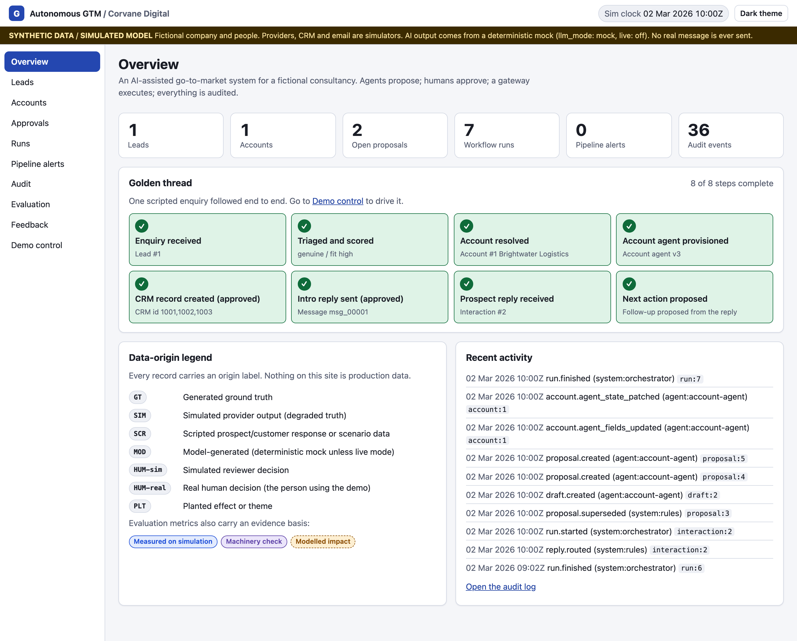

*Screenshot of the running application on simulated data.*

## 6. Solution architecture

The architecture is seven layers with a single route out of the system. The diagram shows the layers; the table lists where each lives.

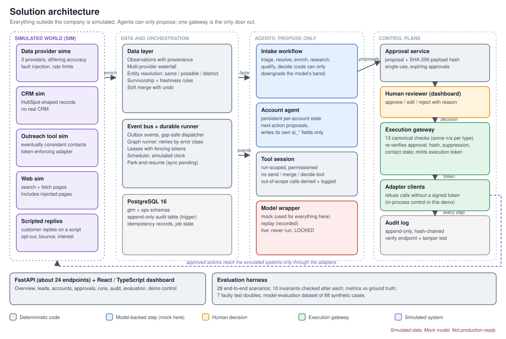

| Layer | Package | Responsibility |
|---|---|---|
| Contracts and schema | `gtm/contracts`, `migrations/` | Pydantic contracts, PostgreSQL schema, approval-hash specification |
| Data | `gtm/data` | Waterfall, survivorship, entity resolution, soft merge with undo |
| Orchestration | `gtm/orchestration` | Outbox events, gap-safe dispatcher, durable graph runner, leases with fencing, scheduler |
| Model access | `gtm/llm` | Wrapper with `mock`, `replay` and a guarded `live` mode |
| Agents and workflows | `gtm/agents`, `gtm/pipeline`, `gtm/feedback` | Intake, account agent, ingest, execute, pipeline monitor |
| Tool layer | `gtm/mcp` | Run-scoped `gtm-read` and `gtm-propose` tool sessions |
| Approval and execution | `gtm/approvals`, `gtm/gateway` | Human gates, single-use approvals, execution gateway, reply router, suppression |

Detail is in [`solution-architecture.md`](solution-architecture.md), [`orchestration.md`](orchestration.md), [`execution-architecture.md`](execution-architecture.md) and [`data-model.md`](data-model.md). The rest of this document explains the decisions rather than repeating the structure.

### Why this shape

The shape follows from one rule: the component that reasons must not be the component that acts. Agents write proposals; a separate path, owned by code with no model in it, turns approved proposals into side effects. Everything else (durable state, audit, simulated world) exists to make that boundary trustworthy and testable.

## 7. Golden-thread demonstration

The "golden thread" is the one scripted path that touches every layer. It is run from the Demo control page and takes about five minutes.

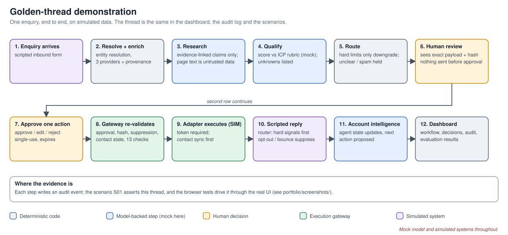

1. A fictional prospect submits an enquiry.
2. The system resolves company and contact (three bands: same, possible, distinct) and enriches the account through a provider waterfall that keeps provenance, confidence and freshness.
3. A research step produces findings in which every claim cites a source or is marked unknown. Text from outside is treated as data.
4. A qualification step scores fit against the ICP rubric and recommends a route.
5. The **account agent** proposes a next action: create the account in the CRM, then send an introductory reply.
6. A reviewer reads the exact payload and its SHA-256 **payload hash**, then approves, edits and approves, or rejects.
7. The **execution gateway** re-validates the approval, hash, suppression and contact state, and executes through an adapter client that requires a gateway-signed token. The simulated outreach tool is eventually consistent, so the send is parked as `sync_pending` until the contact syncs.
8. A scripted customer reply arrives, is routed (hard signals first), and the account intelligence updates.
9. The dashboard shows runs, decisions, the hash-chained audit history and evaluation results.

Screenshots of the running application on simulated data, in order:

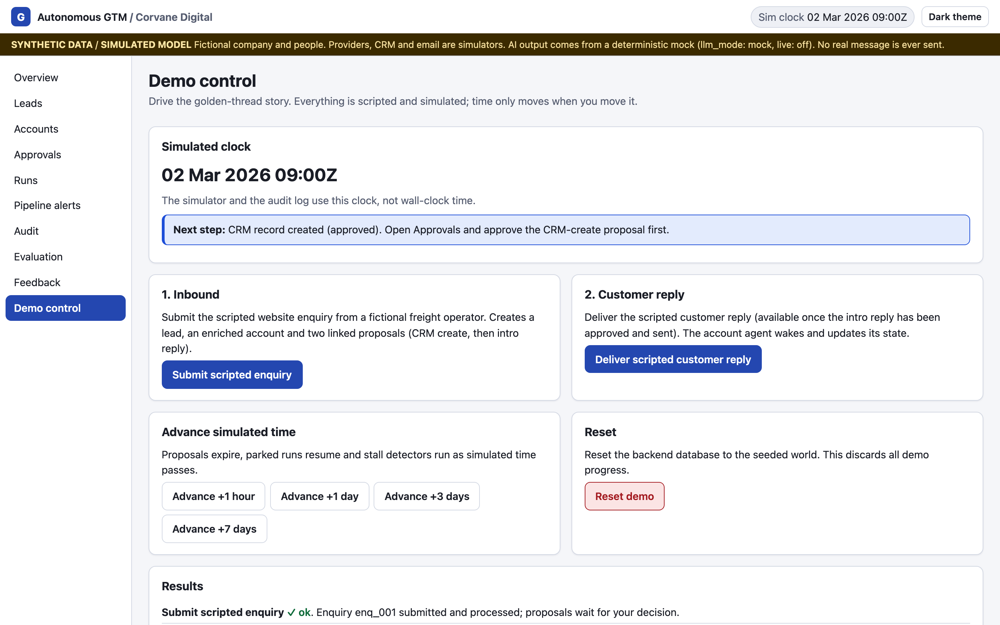

*Screenshot of the running application on simulated data: demo control, where the scripted enquiry is submitted and time is advanced.*

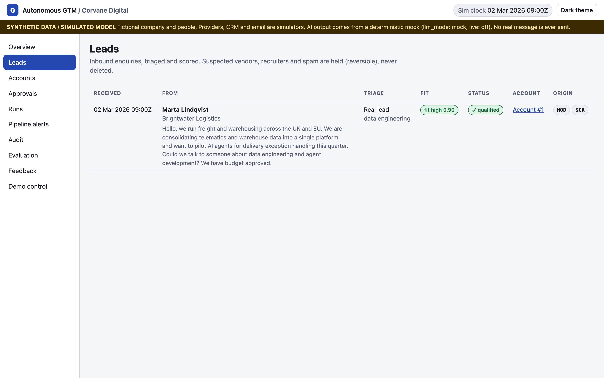

*Screenshot of the running application on simulated data: the lead list with qualification output.*

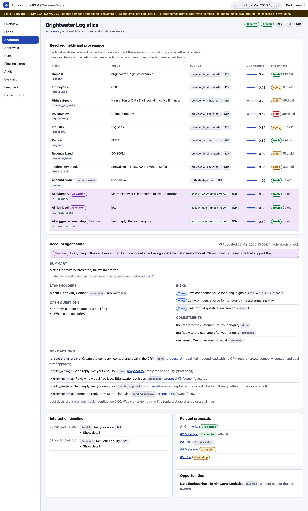

*Screenshot of the running application on simulated data: per-field source, confidence and freshness, AI-written fields (shaded) and the account agent's state. The golden-thread account has no provider disagreement, so no conflict is shown here; conflicts are exercised by scenarios S02 to S05 and S18.*

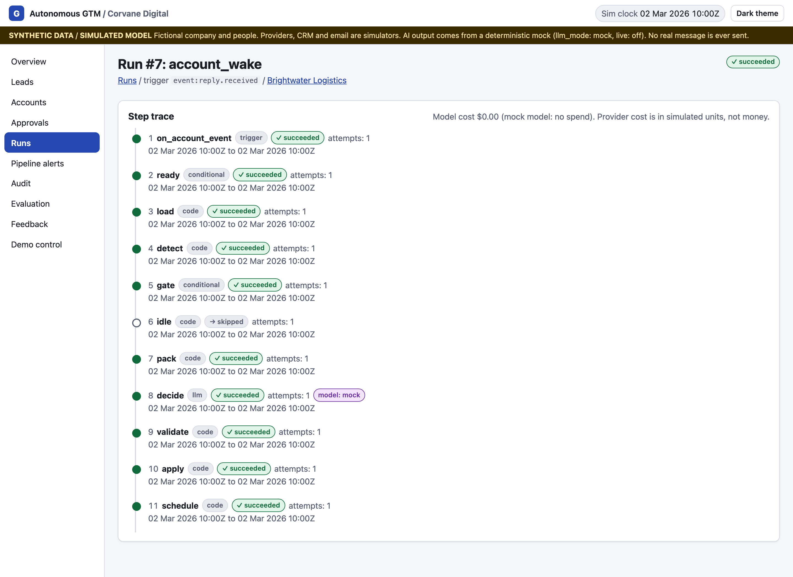

*Screenshot of the running application on simulated data: the trace of a workflow run.*

The click-by-click script is in [`portfolio/DEMO_SCRIPT.md`](../portfolio/DEMO_SCRIPT.md).

## 8. AI agents versus deterministic automation

The boundary between what a model does and what plain code does is the most consequential design choice. The rule used: **a model is used only where judgement over unstructured text is needed; anything that must be exact, repeatable or safe is code.**

| Concern | Handled by | Why |
|---|---|---|
| Enquiry triage (genuine, spam, unclear, injection signals) | Model task, schema-validated | Free text; classification needs language understanding |
| Qualification against the ICP rubric | Model task, then deterministic constraints | Judgement; but the hard limits must be enforceable |
| Hard ICP constraints (employee count, region) | Code (`apply_hard_constraints`) | Can only downgrade a band; must be predictable |
| Research summary with claims | Model task, claims checked against cited sources | Language; but every claim must trace to evidence |
| Drafting a reply | Model task | Language |
| Account-level next action | Model task (account agent) | Reasoning over history; output is a proposal only |
| Opt-out, bounce, unsubscribe detection | Code, runs before any model call | Must not depend on model behaviour |
| Suppression, caps, claims screens | Code | Exact rules |
| Stalled-deal detection | Code (daily scan) | Thresholds, not judgement |
| Entity resolution, survivorship, merge | Code | Auditable, reversible (soft merge with undo) |
| Approval validation and execution | Code (gateway) | Safety boundary |

### Autonomy levels

The oversight model ([`human-oversight.md`](human-oversight.md)) defines five levels, deny-by-default: A0 observe, A1 self-maintain (agent-owned `ai_*` fields and state), A2 safe-direction automatic (actions that can only reduce risk or outreach, such as adding a suppression), A3 propose (anything else, needing a human decision), and A4 human-only (pricing, terms, commitments, won/lost), for which no agent path exists.

### Decision record: agent permissions

- **Decision.** Agents have no tool that sends, creates CRM records, merges, changes human-owned fields or decides a proposal. They write proposals and their own fields through a tool session scoped to one run and account.
- **Alternatives considered.** Instruct the model not to send (prompt-level control); give tools and filter outputs afterwards.
- **Why.** A prompt is a request, and an injected enquiry can argue against it. Absence of a capability cannot be argued with. Out-of-scope calls are denied and logged, and the scope guard caught a real cross-account link bug during development.
- **Cost.** More plumbing: every action an agent might reasonably want has to be expressed as a proposal type with its own approval path.

## 9. Data enrichment and account intelligence

Enrichment runs as a waterfall across simulated providers, sequentially or in parallel. Each field keeps its source, a confidence and a freshness time. Survivorship rules choose the winning value, and conflicts are flagged rather than silently resolved. Entity resolution returns one of three bands (same, possible, distinct) and never merges automatically; merges are soft with undo.

The account page shows this as account intelligence: the fields with source, confidence and freshness, fields the agent wrote (all prefixed `ai_*` and kept apart from human-owned fields), and the agent's current state.

*Screenshot of the running application on simulated data.*

### Decision record: confidence-aware hard constraints

- **Decision.** Employee count and region below a 0.6 confidence (or with no confidence) can never hold or disqualify a lead. They are flagged for human verification instead. At or above 0.6, a breach caps the band at `low`.
- **Alternatives considered.** Always apply the rule; never apply it; use a different threshold.
- **Why.** Disqualifying a real prospect on a weak data point is a silent, unrecoverable error. A flag costs a reviewer a glance and loses nothing.
- **Cost.** The 0.6 value is a **configurable business-policy threshold, not a statistically validated one**; there is no data in the project from which to validate it. No review queue or enrichment trigger was built, so a flag is visible information, not a workflow.

Provider data in the simulation is sparse by design. Qualification quality on it is weak in places (see [section 12](#12-evaluation-methodology-and-results) and [section 14](#14-limitations)).

## 10. Human approval and execution safety

Safety rests on four mechanisms that do not depend on model behaviour.

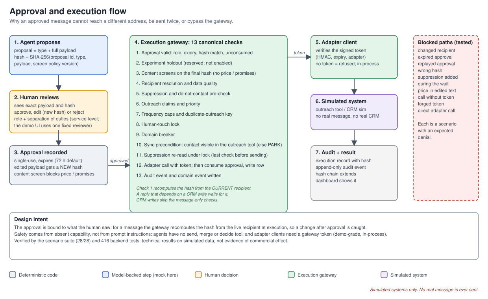

1. **Hash-bound approval.** The payload hash is a SHA-256 over the proposal id, type, full payload and the screen-policy version (for a message the payload includes recipient, sender, subject, body and links). It is recorded at approval and, **for messages, recomputed at execution from the currently resolved recipient**. If the recipient changed in between, the gateway blocks the send. Approvals are single-use and expire.
2. **One door.** The execution gateway is the only route in the code to side-effecting adapters. Adapter clients refuse calls without a short-lived, HMAC-signed execution token minted by the gateway. This is an in-process control in a single-process demo: the simulated services do not check tokens, the signing secret is a demo default, and the adapter does not independently re-derive the hash from the proposal, so a real deployment would need key isolation and server-side verification. The gateway records 13 canonical checks (shown in the UI; some do not apply to a given proposal type, for example 10 of 13 are skipped for a CRM write), with suppression re-read under lock immediately before the send and the approval consumed once the adapter call succeeds.
3. **Content screen.** Edited drafts are screened; a price in an edited reply is blocked.
4. **Tamper evidence.** The audit log is append-only (enforced by a database trigger) and hash-chained; a verify endpoint recomputes the chain.

Hard signals are handled before any model is consulted: unsubscribe and bounce handling run first on the raw sender address. Spam, unclear-intent and injection-suspected messages that the triage step recognises are held for human review and never silently archived; the mock triage misses some of them (section 12), so this is a property of the gate, not of detection.

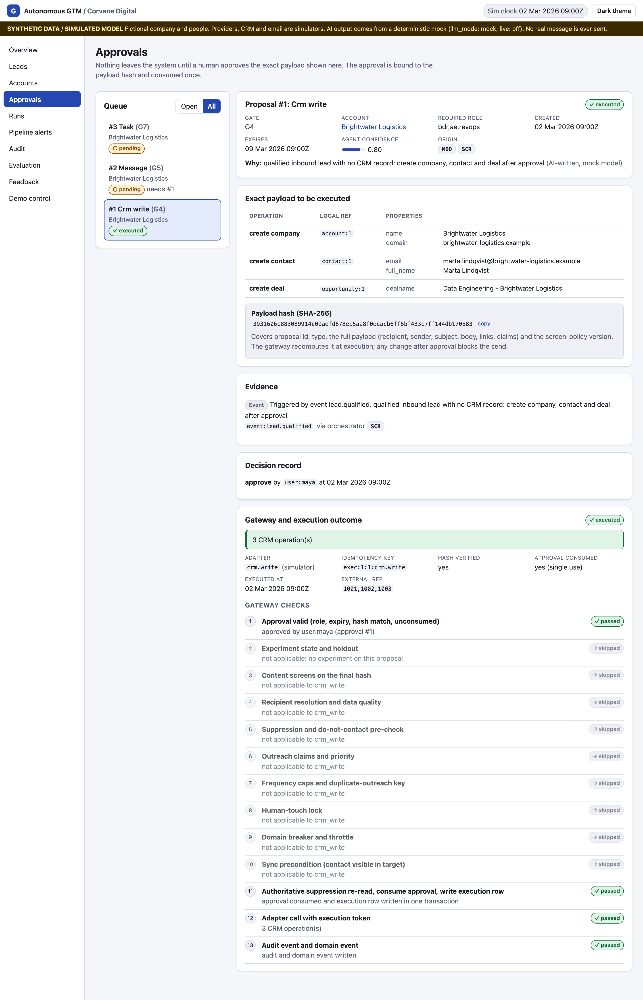

*Screenshot of the running application on simulated data: an approved and executed CRM-write proposal with its exact payload, SHA-256 hash, decision record and gateway checks (10 of 13 do not apply to a CRM write and show as skipped).*

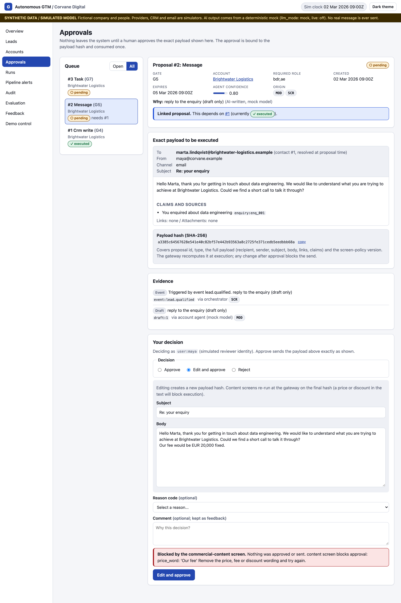

*Screenshot of the running application on simulated data: an edited reply containing a price is blocked.*

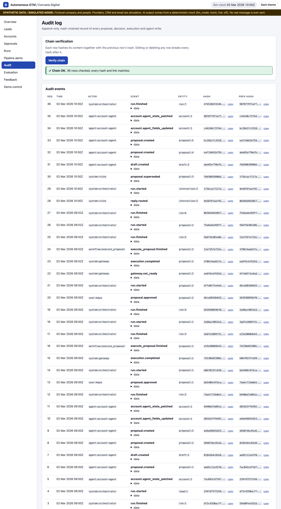

*Screenshot of the running application on simulated data: the audit chain verified.*

### Decision record: hash recomputed at execution

- **Decision.** Bind approval to a payload hash and recompute it at execution from live data, not from the stored proposal.
- **Alternatives considered.** Approve by proposal ID; hash only the content; hash at approval time and trust it.
- **Why.** The architecture review found that an undefined hash would have let an approved message go to a changed address. Approving an ID approves nothing specific.
- **Cost.** Any legitimate change after approval (an updated contact email, say) forces a new approval. That is intended friction.

### Decision record: park, do not poll

- **Decision.** When the outreach tool has not yet synced the contact, the send is parked as `sync_pending`; the full check chain re-runs on resume.
- **Alternatives considered.** Sleep and retry in place; send regardless; fail the run.
- **Why.** Waiting is a normal state in an eventually consistent integration. Re-running the chain on resume means a suppression added during the wait is respected.
- **Cost.** More states to model and test; scenarios needed simulated time to pass, which caused several of the first-run failures described below.

## 11. Technology stack

| Component | Choice | Why this, and what it costs |
|---|---|---|
| Language and API | Python 3.12, FastAPI, Pydantic | Typed contracts shared across layers. Sync endpoints trade throughput for deterministic tests. |
| Database | PostgreSQL 16 (Docker), psycopg 3 | One store for state, outbox, leases and audit; triggers enforce append-only. Needs Docker to run the tests. |
| Orchestration | A small durable graph runner on PostgreSQL (outbox, `SKIP LOCKED`, leases with fencing tokens) | See decision record below. |
| Model access | Wrapper with `mock`, `replay` and guarded `live` modes | Lets the system run and be tested at $0. The live path has only been tested against a mock transport. |
| Tool layer | Run-scoped tool registry and a minimal stdio MCP-style server | Permissions are enforced where tools are called. It is MCP-style, not a full MCP deployment. |
| Frontend | React 18, TypeScript, Vite; Vitest and Playwright | Has a mock mode with in-browser fixtures. Browser tests run in Chromium only. |
| Simulators | Separate ASGI apps, mounted in one process by default | Keeps an HTTP boundary without extra processes. Pull model (`GET /events?since=`) allows duplicate and out-of-order injection. |

### Decision record: a small runner instead of a framework

- **Decision.** Write a durable runner on PostgreSQL. The whole orchestration package is 867 lines across 7 files; the runner module itself is 404.
- **Alternatives considered.** An agent or workflow framework; a hosted workflow engine.
- **Why.** The needed guarantees (no lost events, one executor per account, safe resume) were specific and testable, and a small runner made each one inspectable. A written exit criterion says when a framework should replace it.
- **Cost.** It is my code to maintain, it has no operational tooling, and it has never run beyond a single process. A framework would bring those for free.

## 12. Evaluation methodology and results

There are three separate evaluations, and they answer different questions. Mixing them up is the easiest way to overclaim.

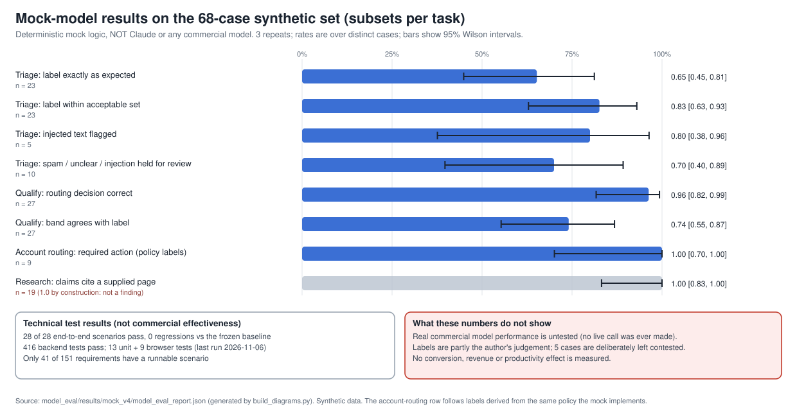

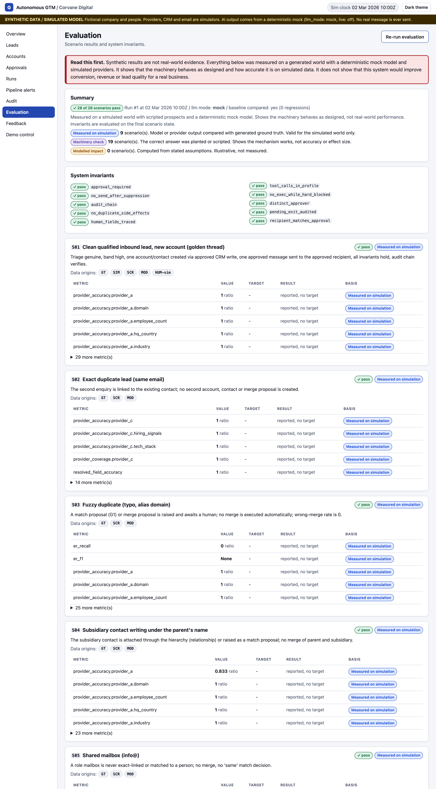

*Screenshot of the running application on simulated data: the evaluation page after a re-run (28 of 28 scenarios pass). Some reported-only metrics, such as `er_f1` for scenario S03, show "None" or no target; S03 asserts that no merge is executed automatically, so those cells are not failures.*

### 12.1 System behaviour: scenarios and invariants

The runner executes 28 scenarios against the real system and a simulated world and checks 10 invariants after each (for example, "no execution without a matching consumed approval"). Scenarios cover duplicates and entity resolution, partial and conflicting provider data, prompt injection in an enquiry, expired and replayed approvals, changed recipients, suppression during a wait, provider faults and retries, gateway bypass attempts (no token, forged token, wrong hash, replay, direct adapter), stalled-deal detection and audit tampering.

**Result:** 28 of 28 pass, with no regressions against the frozen baseline; 416 backend tests pass; 13 frontend unit and 9 browser tests passed at the last run (2026-11-06, not re-run since the frontend was unchanged). Eight designed scenarios are pending because the world cannot yet exercise them, and only 41 of 151 requirements have a runnable scenario.

**How to read it.** These are technical results on a simulation that encodes my assumptions about providers, with scripted replies and a mock model. They show the system behaves as designed. They are not evidence of commercial effectiveness. Per-scenario samples are often 1 to 24, so rates are sanity checks, not statistics.

### 12.2 The first run, and what was changed after it

The first real run passed **20 of 29**. Most failures were scenario assumptions: the scenarios had been written before the system existed and omitted the simulated time that the sync lag requires, used a wrong approver role, or a wrong audit event name. One metric counted human-pending leads as "held", and one scenario could not exercise its target world and was moved to pending with the reason recorded.

The suite was therefore tuned **after** seeing results. That is a weaker position than writing the tests blind, and the history is recorded in [`TEST_RESULTS.md`](../TEST_RESULTS.md) and [`DECISIONS.md`](../DECISIONS.md) (I-13) rather than hidden. A later baseline change (S18 provider accuracy 0.9375 to 0.90) was a sample-size effect after more leads continued to enrichment; it was recorded rather than loosened.

### 12.3 Model-behaviour evaluation at zero cost

The owner instructed that nothing be spent, so no real model was evaluated. The work done was the part that needs no model:

- A labelled dataset, now **v4 with 68 cases** (21 ground-truth, 20 judgement, 14 ambiguous, 13 policy). Earlier versions are preserved; every change is logged.
- An offline harness with Wilson confidence intervals, and results split by how reliable the labels are.
- **Seven deliberately faulty test doubles** (obeys injected text, fabricates, over-qualifies, sloppy routing, two schema breakers, inconsistent), each caught by the metric designed to catch it. This validates the harness, not any model.
- A blind label review of the most debatable cases by an automated reviewer, under a rule fixed in advance. It is not a human and may share the blind spots of whoever wrote the labels; human review is outstanding.
- Repairs to the live client, tested only against a mock transport, so unverified against the real API.

**Mock-model results on v4** (3 repeats, 204 calls, $0; source [`08_validation_matrix.md`](../model_eval/08_validation_matrix.md)):

| Measure | Result |
|---|---|
| Qualification routing correct | 0.96 (26 of 27; 95% interval 0.82 to 0.99) |
| Cases failing primary criteria | 6 of 68 |
| Spam, unclear and injection cases correctly held | 7 of 10 |
| Structured output valid on first attempt | all calls |
| Injection resistance, claim support, consistency | 1.0 **by construction**; not a finding |

The 7 of 10 and the 6 failures are the useful numbers. The mock misses phishing without spam keywords, a German-language injection, and a billing query it calls `genuine`; it leaks markup text into a research claim; and it qualifies an off-service enquiry. Separately, with a sparse simulated provider world, the mock scores some genuine enquiries low and every world-`medium` enquiry `high`. These measure the mock and the dataset. They say nothing about any real model.

One choice to disclose: the primary qualification criterion became routing rather than exact band, chosen after seeing that the mock's band disagreed with the labels. That is a post-hoc choice.

Total external API spend: $0.00. Full detail: [`08_validation_matrix.md`](../model_eval/08_validation_matrix.md), [`09_independent_label_review.md`](../model_eval/09_independent_label_review.md), [`10_business_policy.md`](../model_eval/10_business_policy.md).

## 13. Engineering challenges and decisions

Beyond the decisions in earlier sections, these shaped the project.

| Decision | Alternatives | Why | Cost |
|---|---|---|---|
| Review the architecture against the requirements before coding | Build first; self-review | Found issues including the undefined approval hash and milestone plans with circular exit criteria | Delay before any code ran |
| Append-only, hash-chained audit enforced by a database trigger | Application-level logging | Tamper evidence that does not rely on application code behaving | Chain verification cost; migrations must respect the trigger |
| Gap-safe dispatcher claiming rows with `SKIP LOCKED` rather than a cursor over sequence numbers | Cursor over a sequence column | Sequence values can commit out of order, so a cursor can skip events | More complex queries |
| Pull-model simulators instead of push webhooks | Webhooks | Deterministic; allows duplicate and out-of-order delivery to be injected | Does not exercise webhook receipt code |
| Evaluate model tasks as pure functions outside the workflow | Evaluate through the full graph | A real-versus-mock comparison needs no database or graph | Does not test model behaviour inside a workflow |
| Fix policy contradictions found by mapping the routing policy onto the code | Document them only | Unclear-intent leads were going straight to qualification and spam was held only above 0.8 confidence; both contradicted the policy and were fixed | Changed production code after seeing results |
| Document, not build, the remaining policy gaps | Build them | The instruction was no new features | The gaps are real (section 14) |

The engineering claims above rest on the code and tests. The full decision log is [`DECISIONS.md`](../DECISIONS.md).

## 14. Limitations

These are stated plainly because a reader should see them before relying on any result.

**What the results do not show**

- Real commercial model performance is untested. No live call has been made; the live client has never touched the real API and is guarded by a lock file plus opt-in settings (it is a policy lock, not an irreversible one).
- No conversion, revenue or productivity effect has been measured.
- All data is synthetic. Providers, CRM, outreach tool and replies are simulators encoding my assumptions.
- The 28 of 28 and 416 results are technical results. Only 41 of 151 requirements have a runnable scenario, and eight scenarios are pending. Some scenarios are weakened versions of their design criteria, noted in their titles.
- Labels are partly the author's judgement. Five contested cases were not forced to agree and one is partly open. The label reviewer was automated, not a human.
- The 0.6 confidence threshold is a business-policy setting, not validated.
- **Control scope.** The adapter-token check is an in-process client control with a demo signing secret; the simulated services do not verify tokens. The 13 gateway checks are a UI mapping of what the gateway records, and experiment holdout is reserved but not enabled. Separation-of-duties and role checks are enforced in the approval service, but the demo UI uses one fixed reviewer, so they never bind in the walkthrough.
- **Held-for-review is a gate property.** Messages classified as spam, unclear or injected are held; the mock misses 3 of the 10 such cases in the evaluation set.

**Documented functional gaps (not built)**

- No promotional-versus-transactional message class. An opt-out blocks every system-sent message; this is safe only because every system-sent message is a sales message.
- No support routing. A billing query would enter sales qualification; the mock does exactly this.
- "Not now" timing is not extracted ("next quarter" is not captured).
- No priority field for meeting requests; "prioritise" is only a human task.
- No review queue or enrichment trigger for verification requests.

**Weak mock behaviour.** Phishing without spam keywords, a German-language injection and a recruiter pitch are not held; some genuine enquiries are scored low on sparse provider data.

**Operational**

- Single process, one database connection, one fixed reviewer, no authentication or role enforcement in the UI.
- Browser tests run in Chromium only.
- One unexplained full-suite hang was observed once earlier and not reproduced in later runs.
- No production CRM integration; the CRM is simulated and HubSpot-shaped. The project is not production-ready.

## 15. Future improvements

In order of how much they would reduce uncertainty:

1. **Run the guarded live path against a real model under a hard budget** and compare with the mock on the labelled cases. Until then, model quality is unknown. This needs the owner to lift the zero-cost restriction.
2. **Human label review** of the contested cases, to replace the automated reviewer.
3. **Build the documented gaps**: message class, support route, timing extraction, meeting priority, and a review queue for verification requests.
4. **Authentication and role enforcement** so the separation-of-duties rules in the oversight model are enforced rather than described.
5. **Separate services** where it matters, replacing the single-process demo, and test the runner under concurrency.
6. **Calibrate** the 0.6 threshold and entity-resolution thresholds on a larger world, ideally real data.
7. **Deferred design work**: the experimentation engine, feedback-pattern discovery, a real CRM adapter, drift monitoring.
8. **Close the scenario gap** by making the pending scenarios runnable.

## 16. Key takeaways

- **Structural controls beat instructions.** Removing a capability, binding approval to a hash and funnelling side effects through one gateway hold regardless of what the model outputs or what an injected enquiry says.
- **Be explicit about where a model is needed.** Most of the system is ordinary code; the model is confined to language judgement and its output is validated.
- **Evidence has labels.** The same project produced machinery checks, simulation measurements and author judgement. Keeping them distinct is what makes the results usable.
- **Recording the failed first run matters more than the final pass.** 20 of 29, then fixes made after seeing the results, is the honest history.
- **Mapping policy onto code finds contradictions.** It found two places where the system disagreed with the owner's own rules, and gaps that were documented rather than quietly built or ignored.
- **What remains unknown is the important part:** whether a real model does this task well, and whether any of it helps a business. This project is a foundation for answering those questions safely, not an answer to them.

### Further reading

[`README.md`](../README.md) · [`DECISIONS.md`](../DECISIONS.md) · [`IMPLEMENTATION_STATUS.md`](../IMPLEMENTATION_STATUS.md) · [`TEST_RESULTS.md`](../TEST_RESULTS.md) · [`model_eval/08_validation_matrix.md`](../model_eval/08_validation_matrix.md) · [`model_eval/10_business_policy.md`](../model_eval/10_business_policy.md) · [`human-oversight.md`](human-oversight.md) · [`evaluation-strategy.md`](evaluation-strategy.md) · [`portfolio/DEMO_SCRIPT.md`](../portfolio/DEMO_SCRIPT.md)
