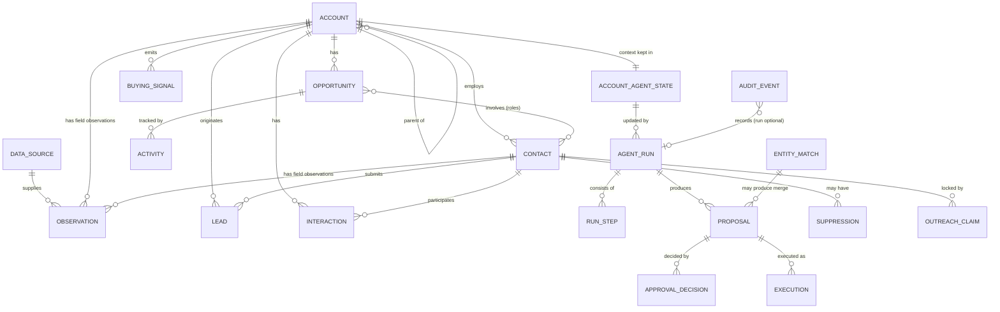
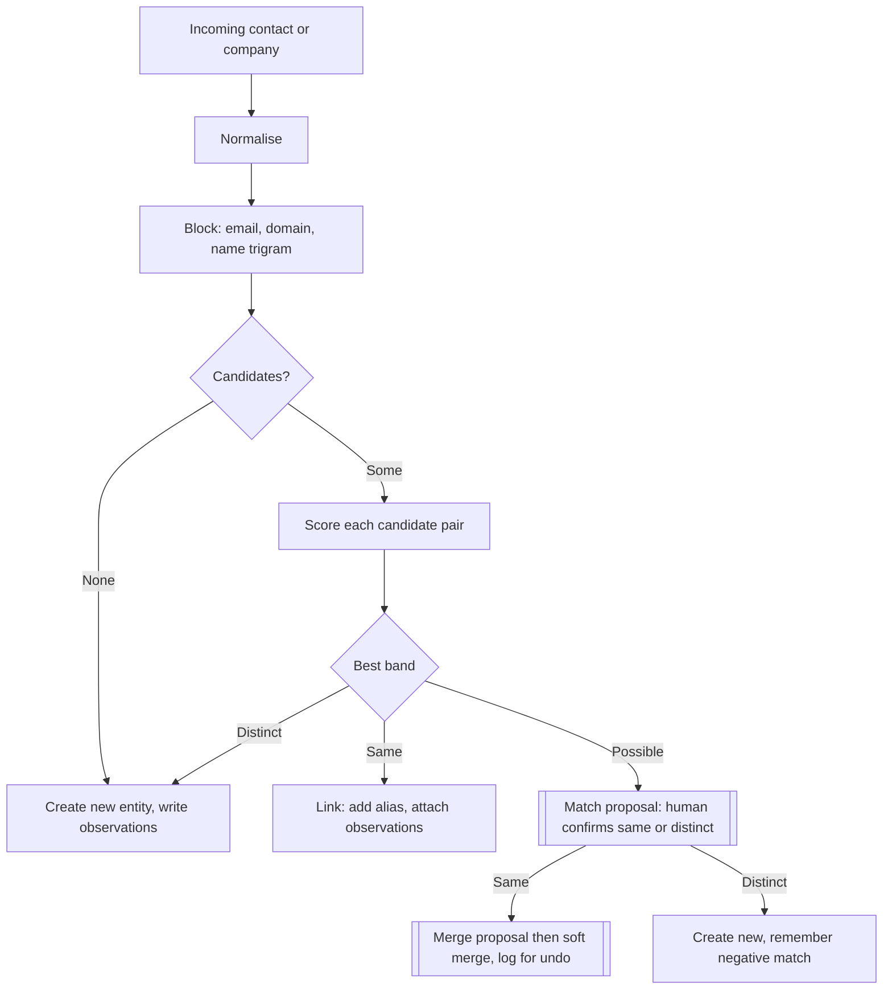
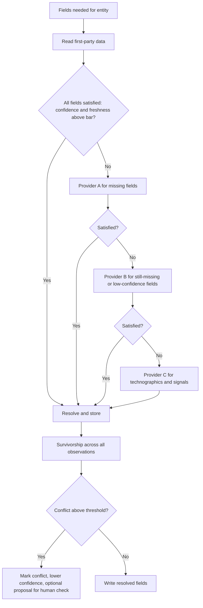
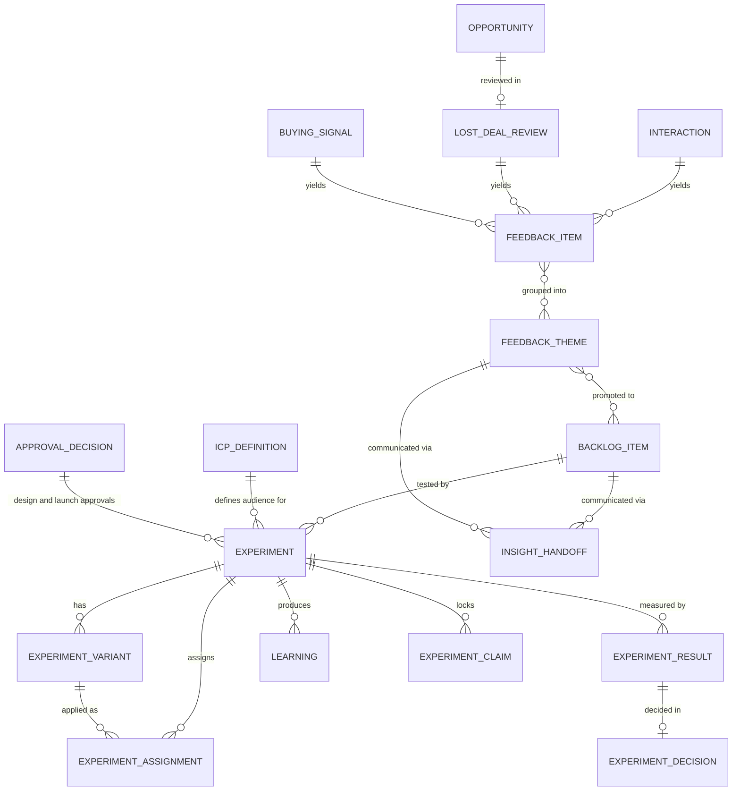

# Data model

**Modified (Phase 3):** replaces the earlier stub. All design is **[P]**. Thresholds, TTLs and weights are **[A]** starting values to be calibrated on the simulators. No application code or DDL is written in this phase; tables are specified as designs.

## 1. Design principles

1. **Observations are immutable; resolved values are derived.** Every datum arrives as an observation with source, time and confidence. The "current value" on an entity is computed by survivorship rules and can be recomputed.
2. **Every field has an owner class** (human, agent, system, provider), and the data layer enforces who may write it.
3. **Destructive operations are soft and reversible** (merge = link with `merged_into`, never delete).
4. **Everything consequential has a lineage:** Agent run, then Proposal, then Approval decision, then Execution, each with an audit event.
5. **Separate counts for separate denominators** (lead, opportunity, proposal), addressing problem P-13.

## 2. Entity-relationship overview

## 3. Core entities

Columns are indicative; every table also has `id`, `created_at`, `updated_at`, and (where relevant) `source_system` and `external_ids`.

### 3.1 Account and hierarchy

| Table | Key columns | Notes |
|---|---|---|
| `account` | `name`, `primary_domain`, `status` (prospect, customer, former, disqualified), `owner_user_id`, `parent_account_id`, `hierarchy_role` (ultimate_parent, subsidiary, division, standalone), `merged_into_id` | Resolved scalar fields (industry, employee band, region) are projections of observations |
| `account_domain` | `account_id`, `domain`, `is_primary` | A company may own several domains; domain is the strongest match key |
| `account_relationship` | `from_account_id`, `to_account_id`, `type` (parent_of, partner_of, competitor_of), `source`, `confidence` | Hierarchy is a relationship with provenance, not hard-coded |

**Hierarchy rules [P]:** contacts and leads attach to the *most specific* account the evidence supports; opportunities attach to the account that buys (often a subsidiary); reporting rolls up to the ultimate parent; ownership defaults to the parent's owner but a child may have its own owner (conflict raises a routing proposal, not an automatic change).

### 3.2 Contact and lead

| Table | Key columns | Notes |
|---|---|---|
| `contact` | `account_id`, `full_name`, `email` (normalised), `title`, `seniority`, `persona`, `owner_user_id`, `merged_into_id` | Email domain is cross-checked against `account_domain` |
| `lead` | `contact_id`, `account_id`, `channel` (form, email, referral, outbound_reply), `raw_payload_ref`, `idempotency_key`, `triage_class`, `fit_score`, `fit_rationale`, `status` | A lead is an event-like record. The person persists as a contact |

### 3.3 Opportunity

| Table | Key columns | Notes |
|---|---|---|
| `opportunity` | `account_id`, `name`, `service_line`, `stage`, `amount`, `close_date`, `owner_user_id`, `forecast_category`, `next_step`, `source_lead_id` | `stage`, `amount`, `close_date`, `owner`, `forecast_category` are **human-owned** |
| `opportunity_contact` | `opportunity_id`, `contact_id`, `role` (champion, economic_buyer, technical, blocker) | Needed for single-threading detection |
| `stage_history` | `opportunity_id`, `from_stage`, `to_stage`, `changed_by`, `at` | Dwell-time metrics |

### 3.4 Signals, interactions and activities

The distinction **[P]**: an **interaction** is communication between us and the customer (email, meeting, call, form); an **activity** is internal work or a CRM timeline entry (task, note, stage change, system action). A **signal** is an inferred or third-party fact that may matter.

| Table | Key columns | Notes |
|---|---|---|
| `buying_signal` | `account_id`, `type` (hiring, funding, tech_change, leadership_change, content_engagement, intent_topic), `description`, `strength`, `observed_at`, `expires_at`, `data_source_id`, `evidence_ref` | Signals decay; `expires_at` drives relevance |
| `interaction` | `account_id`, `contact_ids`, `channel`, `direction`, `occurred_at`, `subject`, `body_ref`, `thread_id`, `classification` | Bodies stored as documents, treated as untrusted text |
| `transcript` | `interaction_id`, `text_ref`, `speaker_map` | Synthetic only |
| `activity` | `opportunity_id`/`account_id`, `type`, `actor` (user, agent, system), `due_at`, `status` | Tasks created by agents are proposals first |

### 3.5 Data sources, observations and enrichment

| Table | Key columns | Notes |
|---|---|---|
| `data_source` | `name`, `kind` (first_party, provider, human_entered, inferred), `cost_per_call`, `latency_ms_typical`, `field_reliability` (per-field prior, JSON), `ttl_policy`, `enabled` | Registry used by the waterfall and by provider evaluation |
| `observation` | `entity_type`, `entity_id`, `field`, `value`, `value_normalised`, `data_source_id`, `observed_at`, `fetched_at`, `confidence`, `raw_ref`, `run_id`, `superseded_by` | The core provenance record. Never updated, only superseded |
| `enrichment_request` | `entity_type`, `entity_id`, `fields_wanted`, `status`, `providers_tried`, `cost_total`, `run_id` | One per waterfall execution |
| `resolved_field` (view or table) | `entity_type`, `entity_id`, `field`, `value`, `confidence`, `freshness_state`, `winning_observation_id`, `conflict_flag`, `resolved_at` | Materialised result of survivorship |

"Enrichment record" in the brief equals `enrichment_request` (the act) plus `observation` rows (the results).

### 3.6 Agent, approval and audit

| Table | Key columns | Notes |
|---|---|---|
| `account_agent_state` | `account_id`, `version`, `lifecycle` (unprovisioned, active, quiet, dormant, archived, needs_attention), `summary`, `stakeholder_map`, `commitments`, `risks`, `hypotheses`, `open_questions`, `next_actions`, `feedback_digest`, `context_hash`, `last_woken_at`, `next_wake_at`, `consecutive_failures` | The persistent state. See [account-agents.md](account-agents.md). Optimistic locking via `version` |
| `agent_run` | `workflow`, `trigger_event_id`, `account_id`, `status`, `started_at`, `ended_at`, `model_ids`, `tokens_in`, `tokens_out`, `cost`, `parent_run_id`, `idempotency_key` | One row per graph execution or agent wake |
| `run_step` | `run_id`, `node_id`, `node_type`, `attempt`, `status`, `input_ref`, `output_ref`, `error_class`, `started_at`, `ended_at`, `cost` | The trace |
| `tool_call` | `step_id`, `tool_name`, `args`, `result_ref`, `permitted`, `latency_ms` | Includes denied calls |
| `proposal` | `type`, `target_entity`, `payload`, `payload_hash`, `evidence_refs`, `rationale`, `confidence`, `proposed_by_run_id`, `status` (pending, approved, approved_edited, rejected, expired, superseded, executing, parked, blocked, executed, failed; see section 11.1), `expires_at`, `required_role` | Anything agents want done to the outside world or to protected fields |
| `approval_decision` | `proposal_id`, `decided_by`, `decision` (approve, approve_with_edits, reject), `edited_payload_hash`, `reason_code`, `comment`, `decided_at` | Execution requires an approval whose hash matches the payload |
| `execution` | `proposal_id`, `idempotency_key`, `adapter`, `status`, `external_ref`, `attempts`, `error` | One executed side effect |
| `audit_event` | `seq`, `at`, `actor_type`, `actor_id`, `event_type`, `entity_ref`, `run_id`, `proposal_id`, `data` (redacted) | Append-only; see section 8 |
| `domain_event` | `seq`, `type`, `account_id`, `payload`, `occurred_at`, `dedupe_key` | The event bus backbone (outbox pattern) |

### 3.7 Execution-support entities

`suppression` (contact/domain/account, reason, scope, expires), `outreach_claim` (contact or account, purpose, priority, holder, expires), `outbox_message` (draft content, hash, channel, status), `sync_state` (entity, system, state, last_checked). Used in [execution-architecture.md](execution-architecture.md) and [orchestration.md](orchestration.md).

## 4. Field ownership

The strongest control against agents corrupting the CRM. **[F]** the talk, as summarised, recommends separating agent-owned, human-owned and deterministic-system-owned fields. The class names and enforcement design are **[P]**.

| Owner class | Who may write | Write path | Examples |
|---|---|---|---|
| **Human-owned** | Named users only | Direct by user; agents may *propose* | opportunity stage, amount, close date, owner, forecast category, account status, contact consent |
| **System-owned** | Deterministic code only | Direct, by code nodes with a rule | source, created_at, dedupe keys, `is_stalled` (computed), days_in_stage, lifecycle flags, sync state |
| **Provider-owned** | Enrichment layer via observations | Observation, then survivorship | industry, employee band, revenue band, HQ country, technologies, domain |
| **Agent-owned** | Account agent (and its tools) | Direct, to namespaced `ai_*` fields | `ai_summary`, `ai_risk_level`, `ai_next_action`, `ai_last_reviewed_at`, `ai_confidence` |
| **Shared (proposal-gated)** | Anyone via proposal | Proposal, approval, execution | contact title correction, hierarchy link, merge |

Enforcement **[P]**: a `field_policy` table lists `(entity, field) → owner_class, write_mode (direct, proposal, never), validation`. The data-access layer checks the caller's principal against it on every write, and the CRM adapter mirrors the same policy when writing to the simulated CRM. A human editing an agent-owned field takes ownership of that value ("human pin"); the agent then treats it as a constraint. Agent-owned fields are visibly labelled in the CRM so humans know what to trust less.

## 5. Entity resolution

### 5.1 Goals
Avoid duplicates (FR-INB-02, risk R-04) without wrongly merging distinct entities, which is the more damaging error.

### 5.2 Process **[P]**

1. **Normalise:** lowercase emails; strip plus-addressing for matching only; normalise domains (drop `www`, resolve known aliases); canonicalise company names (legal suffixes, punctuation, transliteration).
2. **Block:** candidate generation by cheap keys: exact email, exact normalised domain, name trigram similarity (Postgres `pg_trgm`), phone.
3. **Score:** weighted features per candidate pair (email equal, domain equal, name similarity, title similarity, location agreement, shared contacts). Weights start hand-set **[A]**; calibrated against the labelled pair set.
4. **Decide, in three bands:**

| Band | Condition **[A]** | Outcome |
|---|---|---|
| Same | exact email match, or exact domain plus name similarity above 0.9 | **Link**: record the external id/alias, reuse the existing entity. Non-destructive, automatic |
| Possible | score between 0.6 and 0.9, or conflicting strong keys | **Match proposal** for human review. Not auto-merged |
| Distinct | below 0.6 | Create new entity |

5. **Merge** (combining two existing records) is always a proposal. It is executed as a soft merge: loser gets `merged_into_id`, observations are re-pointed, a `merge_log` row allows undo.
6. **Hard cases:** shared mailboxes (info@, sales@) never match people; free-mail domains (gmail) are not account keys; consultants and agencies working for a client are flagged with a contact-affiliation type; subsidiary versus parent is resolved by the hierarchy rules in section 3.1.

### 5.3 Entity-resolution decision flow

Negative matches are stored so a human's "these are different" decision is never re-asked.

## 6. Data waterfall (simulated)

### 6.1 Provider simulators

Three mock providers plus first-party data, each a small HTTP service backed by a **ground-truth dataset** (the true company and contact attributes of the synthetic world). Each simulator degrades the truth with tunable behaviour:

| Source | Coverage | Accuracy | Staleness | Cost per call | Latency | Failure modes | Strengths **[A]** |
|---|---|---|---|---|---|---|---|
| Provider A (broad, cheap) | ~90% of entities | ~80% per field | up to 18 months | 1 unit | fast | occasional 429 | domain, name, rough size |
| Provider B (accurate, narrow) | ~45% | ~95% | up to 3 months | 10 units | slower | timeouts | employee count, revenue band, hierarchy |
| Provider C (tech/signals) | ~60% | ~85% | up to 2 months | 5 units | medium | partial responses | technographics, hiring signals |
| First-party (CRM, forms, past emails) | whatever we have | ~99% where present | varies | 0 | instant | none | contact details, history |

All parameters are config **[A]**. Because we know the truth, provider accuracy is measurable, not guessed.

### 6.2 Waterfall logic **[P]**

Per requested field: order sources by (expected cost per correct answer) using their `field_reliability`, ask in order, stop when a result meets the field's confidence and freshness bar, otherwise continue. Some fields use *parallel* queries (fan-out) when latency matters more than cost; both modes exist so the evaluation can compare them.

Budget: each enrichment run has a cost cap in simulated units. When the cap is hit, the run finishes with what it has and marks remaining fields `unknown`.

## 7. Conflict resolution, confidence and freshness

### 7.1 Survivorship (which value wins)

Per field, in order **[P]**:
1. **Human-entered** values win unless older than their TTL and contradicted by two independent sources (then a proposal asks the human).
2. Otherwise compute a score for each distinct value: `score = prior_reliability(source, field) × freshness_factor(age, ttl) × corroboration`.
3. Highest score wins. If the runner-up is within 15% **[A]**, mark `conflict_flag` and cap confidence.
4. Superseded observations are retained, never deleted.

### 7.2 Confidence **[P]**

Observation confidence starts at the source's field prior. Agreement from independent sources combines as `1 − (1 − c1)(1 − c2)`. Disagreement leaves the winner's confidence reduced by the runner-up's strength. These are heuristics, not calibrated probabilities. Calibration is part of the evaluation: confidence bins are compared to measured accuracy against ground truth.

### 7.3 Freshness

| Field group | TTL **[A]** | Behaviour at expiry |
|---|---|---|
| Domain, legal name | 365 days | Re-verify on next use |
| Employee band, revenue band, industry | 120 days | Re-enrich if account is active; otherwise lazy |
| Technographics | 60 days | Re-enrich before outreach or meetings |
| Hiring and intent signals | 14 days | Expire; no longer used in scoring |
| Contact title and employment | 90 days | Re-verify before outreach |

`freshness_state` is `fresh`, `stale` or `expired`. Expired values are shown but not used for scoring. Enrichment is *lazy by default* (refresh on demand), with scheduled refresh only for accounts with open opportunities, to bound cost.

## 8. Update policies

| Situation | Policy |
|---|---|
| New observation, no conflict | Written; resolved value updates automatically for provider- and system-owned fields |
| Observation conflicts with a human-owned value | Never overwrites. Creates a "suggested correction" proposal if confidence is high |
| Agent wants to change a human-owned field | Proposal only |
| Agent updates its own `ai_*` fields | Direct, logged, rate-limited (no more than one write per field per wake) |
| Provider returns lower-quality data than before | Keep the better-scored observation |
| Record merged | Soft merge, undo log, human approval |
| Sync from CRM changes a field | Treated as a new observation from source `crm` with owner semantics preserved |
| Bulk change above N records **[A]** | Blocked pending approval (blast-radius limit) |

**Audit log integrity [P]:** `audit_event` is append-only. The application role has insert-only permission; updates and deletes are denied at the database level. A hash chain across events is a cheap optional enhancement for tamper evidence, listed as "later".

## 9. Retention and privacy

All data in this repository is synthetic. In the design: personal data is minimised, audit data redacts contact details where possible (NFR-SEC-04), and retention and deletion policies would be required in a real deployment (not implemented).

## 10. Additions for the GTM product loop (design, **[P]**)

Context: [gtm-product-loop.md](gtm-product-loop.md), [experimentation-engine.md](experimentation-engine.md).

### 10.1 Entities

| Table | Key columns | Owner class of key fields |
|---|---|---|
| `feedback_item` | `interaction_id` or `signal_id` or `lost_deal_review_id`, `account_id`, `contact_id`, `source_type`, `kind`, `topic`, `label`, `quote`, `quote_span` (location in source), `speaker_role`, `sentiment`, `segment_snapshot` (JSON), `extracted_by_run_id`, `confidence`, `review_status` (suggested, confirmed, edited, rejected) | Extraction fields agent-owned; `review_status` human-owned. **Quote must be found in source; enforced on write** |
| `feedback_theme` | `title`, `definition`, `kind`, `status` (candidate, watch, confirmed, merged, retired), `distinct_accounts`, `occurrences`, `first_seen`, `last_seen`, `segment_breakdown`, `revenue_linked` | Counts and breakdowns system-owned (recomputed); status human-owned |
| `feedback_theme_link` | `feedback_item_id`, `theme_id`, `assigned_by` (agent or human), `confidence` | Human assignment overrides agent assignment and is remembered |
| `lost_deal_review` | `opportunity_id`, `primary_reason` (taxonomy), `secondary_reasons`, `competitor`, `debrief_held` (bool), `notes`, `captured_by`, `ai_suggested_tags` | Reasons human-owned; AI suggestions separate and labelled |
| `backlog_item` | `type`, `target`, `title`, `description`, `source_theme_ids`, `occurrences`, `distinct_accounts`, `affected_teams`, `impact` (+ rationale), `revenue_relevance` (computed), `effort` (+ rationale), `advisory_score`, `priority`, `status`, `owner`, `outcome`, `linked_experiment_ids`, `linked_workflow_version` | Counts and `advisory_score` system-owned; `priority`, `status`, `impact`, `owner` human-owned; description may be agent-drafted |
| `insight_handoff` | `theme_id` or `backlog_item_id`, `recipient_role`, `sent_at`, `status` (sent, acknowledged, actioned, declined), `response_note` | Status human-owned |
| `icp_definition` | `version`, `criteria` (JSON), `rubric_ref`, `approved_by`, `effective_from` | Human-owned, versioned; used by qualification and experiments |
| `experiment` | `hypothesis`, `type`, `status`, `owner`, `backlog_item_id`, `icp_version`, `audience_spec` (JSON), `audience_snapshot_ref`, `primary_metric`, `guardrails`, `min_sample_per_arm`, `min_runtime`, `max_runtime`, `analysis_points`, `stop_rules`, `design_hash`, `design_approval_id`, `launch_approval_id` | Status transitions human-owned except automatic pause |
| `experiment_variant` | `experiment_id`, `name`, `parameters` (workflow version, rubric version, timing, persona…), `allocation` | Human-approved with the design |
| `experiment_assignment` | `experiment_id`, `entity_type`, `entity_id`, `variant_id`, `assigned_at`, `holdout`, `excluded_reason` | System-owned; deterministic from hash |
| `experiment_claim` | `entity_type`, `entity_id`, `experiment_id`, `expires_at` | System-owned; mutual exclusion |
| `experiment_result` | `experiment_id`, `analysis_point`, `per_variant_counts`, `rates`, `intervals`, `method`, `label` (conclusive, directional, inconclusive), `computed_at`, `code_version` | System-owned (code); immutable snapshots |
| `experiment_decision` | `experiment_id`, `result_id`, `recommendation` (rule-based), `narrative`, `decision` (continue, modify, stop, ship), `decided_by`, `rationale` | Recommendation system-owned; decision human-owned |
| `learning` | `experiment_id` or `theme_id`, `statement`, `evidence_refs`, `created_by` | Human-owned |

### 10.2 Relationships

### 10.3 Rules

1. **Evidence integrity:** a `feedback_item` cannot be stored without a quote that matches its source text; the check is in the data layer, not the prompt.
2. **Counts are derived, not typed.** Theme and backlog counts are recomputed from links (distinct accounts, not mentions).
3. **Segment snapshot** is copied at extraction time, so later changes to the account do not rewrite history.
4. **Cross-account access:** these tables are read in aggregate only by the insight service's portfolio-read scope; account agents see only their own account's feedback items.
5. **Immutability:** experiment design (after approval), assignments and result snapshots are append-only. A design change creates a new version.
6. **Events:** `feedback.captured`, `theme.updated`, `backlog.status_changed`, `experiment.status_changed`, `experiment.guardrail_breached`, `experiment.result_ready` join the `domain_event` stream.

## 11. Review amendments: mechanics, missing definitions and corrections

*Added after design review. Where this section differs from earlier text, this section governs. All **[P]**; names and thresholds **[A]**.*

### 11.1 Corrections to earlier sections
- **`proposal.status`** is: pending, approved, approved_edited, rejected, expired, superseded, executing, parked, blocked, executed, failed (matches the lifecycle in [human-oversight.md](human-oversight.md) section 3). `blocked` carries `block_class`: **soft** (returns to pending with the reason) or **hard** (suppression/do-not-contact; terminal, cannot be re-approved).
- **`account_agent_state.lifecycle`** is: unprovisioned, active, quiet, dormant, archived, needs_attention.
- **Hierarchy** has one source of truth: `account_relationship`. `account.parent_account_id` is a derived convenience set by code.
- **`audit_event.run_id`** is optional (human and rule actors have no agent run).
- The ER diagrams in sections 2 and 10.2 are **partial views**; this section lists tables they omit.

### 11.2 Event bus and scheduling tables

| Table | Key columns | Purpose |
|---|---|---|
| `domain_event` | `id`, `seq`, `type`, `account_id` (nullable), `entity_ref`, `payload`, `occurred_at`, `recorded_at`, `source`, `source_version`, `schema_version`, `dedupe_key` (unique), `ordering_key` | Event backbone (outbox pattern) |
| `subscription` | `event_type`, `workflow`, `filter`, `enabled` | Maps events to workflows |
| `dispatch` | `event_id`, `subscription_id`, `status` (pending, enqueued, done, dead), `attempts` ; unique (`event_id`, `subscription_id`) | One delivery per subscriber; dispatcher claims pending rows with `SKIP LOCKED`, so it does not depend on `seq` being gap-free |
| `job` | `id`, `run_id`, `workflow`, `target` (node or wake), `status` (queued, leased, done, failed, dead), `lease_owner`, `lease_expires_at`, `attempts`, `available_at`, `idempotency_key` (unique) | Durable queue |
| `schedule` | `kind` (heartbeat, scan, digest, experiment_monitor), `target`, `cadence`, `next_run_at`, `enabled` | **Single source** for time-based triggers. `account_agent_state.next_wake_at` is a read-only mirror |
| `account_lease` | `account_id`, `holder_run_id`, `fencing_token` (= state version), `expires_at`, `renewed_at` | One state-writing run per account; renewed every ~30 s; writes with a stale fencing token are rejected |

### 11.3 Tables previously referenced but not defined

| Table | Key columns |
|---|---|
| `suppression` | `scope` (contact, address, domain, account), `value`, `reason` (unsubscribe, bounce, complaint, dnc, manual), `source_event_id`, `created_at`, `expires_at` (null = permanent), `lifted_by`, `lifted_evidence`, `lifted_at` (lifting is human-only and needs evidence) |
| `outreach_claim` | `entity_type`, `entity_id`, `purpose`, `priority`, `holder_ref` (sequence, experiment or workflow), `expires_at` |
| `draft_store` (called `outbox_message` in section 3.7; "outbox" in execution-architecture means this, not the event outbox) | `proposal_id`, `version`, `channel`, `resolved_recipient`, `sender_identity`, `subject`, `body`, `links`, `attachments`, `content_hash`, `status` |
| `sync_state` | `entity_type`, `entity_id`, `system`, `state` (unknown, pending, visible, enrolled, failed, timed_out), `external_ref`, `last_checked_at`, `deadline_at` |
| `entity_match` | `left_ref`, `right_ref`, `score`, `features`, `band`, `decision` (pending, same, distinct), `decided_by`, `is_negative` |
| `merge_log` | `loser_id`, `survivor_id`, `moved_observation_count`, `approval_id`, `undone_at` |
| `field_policy` | `entity`, `field`, `owner_class`, `write_mode`, `validation`, `principal_exceptions` (e.g. the experiment auto-pause may write `experiment.status`; the insight service reads cross-account) |
| `principal`, `role_assignment` | `principal(id, type [human, agent_profile, service, system], display)`; `role_assignment(principal_id, role, scope)`. `approval_decision.decided_by` and `audit_event.actor_id` reference `principal` |
| `version_registry` | `kind` (workflow, prompt, skill, rubric, model, screen_policy), `name`, `version`, `content_hash`; `agent_run` stores the set of versions used |
| `gate_catalog` | `gate_id`, `proposal_type`, `approver_roles`, `sla`, `expiry`, `requires_distinct_approver` |
| `decision_record` | `gate_id`, `subject_ref`, `decision`, `reason_code`, `decided_by`, `at` (used by gates that decide on data rather than execute actions) |
| `notification` | `recipient`, `type`, `ref`, `status` |
| `sending_domain_stats` | `domain`, `window`, `sends`, `bounces`, `complaints`, `breaker_state` |

Opportunity gains system-owned columns `is_stalled`, `stall_reason`, `days_in_stage` (set only by the pipeline monitor U7, which owns stall detection; the account agent consumes them).

### 11.4 Gate-to-data mapping

| Gate | Subject | Recorded as |
|---|---|---|
| G1 | match confirmation | proposal `match_confirmation` → `entity_match.decision` |
| G2 | merge | proposal `merge` → `merge_log` |
| G3 | lead disposition | proposal `lead_disposition` |
| G4 | CRM create/update | proposal `crm_write` |
| G5 | message | proposal `message` |
| G6 | human-owned field change | proposal `field_change` (Won/Lost are human-initiated in the CRM, not agent-proposable; closed-lost creates a review task) |
| G7 | task | proposal `task` |
| G8 | opportunity from signal | proposal `opportunity_from_signal` |
| G9 | escalation review | `decision_record` + `notification` |
| G10 | sequence step | proposal `sequence_step` |
| G11 | theme confirmation | `decision_record` |
| G12 | backlog priority and promotion | `decision_record` |
| G13 | insight handoff | `decision_record` |
| G14 | experiment design | `approval_decision` referenced by `experiment.design_approval_id` |
| G15 | experiment launch | `approval_decision` referenced by `experiment.launch_approval_id` |
| G16 | experiment decision | `decision_record` (the "no stop or ship without a recorded human decision" invariant is checked against it) |

### 11.5 Audit integrity and minimum record for automatic actions
- **Hash chain in the MVP** (previously "later"): each `audit_event` stores `prev_hash` and `hash`. It is cheap and makes tampering detectable; the application role remains insert-only.
- Automatic actions (A1/A2) have no proposal or human approver, so NFR-AUD-01 is amended to accept "agent run **or rule/system actor with rule id and version**". Minimum fields: actor, rule or model id and version, input reference, confidence if any, outcome, reversal reference (how to undo).
- Redaction is by reference: sensitive content stays in access-controlled storage under the same content hash; the audit row holds the reference.

### 11.6 Data provenance labels
Every non-production record carries `data_origin`: `GT` (generated ground truth), `SIM` (simulated provider output), `SCR` (scripted prospect or customer response), `MOD` (model-generated, with model id and run mode), `HUM-real`, `HUM-sim` (simulated reviewer), `PLT` (planted effect or theme). Taxonomy rules for metrics are in [evaluation-strategy.md](evaluation-strategy.md) section 9.

### 11.7 Terminology
- **Reviewer feedback** (reason codes on approval decisions, `feedback_digest`) is distinct from **customer feedback** (`feedback_item`, `search_feedback`).
- **Event outbox** (domain events) is distinct from the **draft store** (messages awaiting approval).
- **Layers** are L1 to L7; **autonomy levels** are A0 to A4 ([human-oversight.md](human-oversight.md) section 9).
