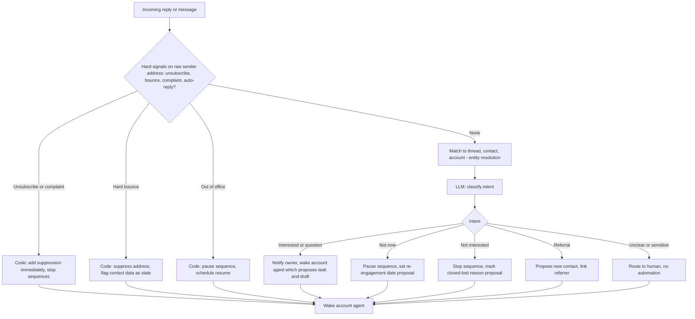

# Execution architecture

**New file (Phase 3).** Design only, **[P]**. The talk, as summarised by the project owner, names reply routing, email-domain reputation, sequence suppression, avoiding conflicting campaigns and coordinating humans with agents as the execution concerns **[F, via owner summary]**. The rules below are our design, bounded by our safety decisions.

## 1. Non-negotiable safety rules (unchanged from Phases 1 and 2)

1. No agent can send an external communication. No such tool exists.
2. No agent can commit pricing, dates, scope or terms.
3. No unauthorised CRM modification (field ownership, [data-model.md](data-model.md) section 4).
4. A send happens only as a **human-initiated action**: the human's approval of an exact message is what triggers the gateway, which then performs that message only.

Terminology **[P]**: *draft* is agent- or human-authored content; *proposal* is a request to do something; *approval* is a recorded human decision bound to a payload hash; *execution* is the gateway performing exactly the approved payload. Agents create drafts and proposals. They never create approvals or executions.

## 2. Components

```mermaid
flowchart LR
    AG[Agents and workflow nodes] -->|draft, proposal| OB[(Outbox: drafts and proposals)]
    OB --> UI[Reviewer dashboard]
    UI -->|approve, edit, reject| AP[Approval service]
    AP -->|approval bound to payload hash| GW
    subgraph GW[Execution gateway: deterministic code only]
        P1[Verify approval: hash, expiry, role] --> P2[Suppression and do-not-contact]
        P2 --> P3[Outreach claims: conflicting campaigns]
        P3 --> P4[Frequency caps and duplicate-outreach key]
        P4 --> P5[Domain reputation circuit breaker and throttle]
        P5 --> P6[Sync precondition: contact visible in target]
        P6 --> P7[Perform action via adapter]
    end
    P7 --> CH[Channel adapters: simulated email, CRM, calendar tasks]
    CH --> X[Simulated outside world]
    X -->|replies, bounces, bookings| RR[Reply router]
    RR --> BUS((Event bus))
    BUS --> AG
    GW --> AU[(Audit log)]
    RR --> AU
```

Any check failing in the gateway blocks the action, records the reason, and returns the item to the reviewer with an explanation. The gateway has no model calls.

## 3. Drafts and communications

- Drafts are produced by LLM nodes from the context pack and (for outbound) the dossier. Each factual claim cites a source, checked by a code step (FR-OUT-04). Drafts never contain pricing, delivery dates or scope commitments (FR-CUS-06); a code-level screen flags numbers, currency and date commitments and demotes the draft to "needs careful review".
- A draft is immutable once submitted. An edit by the human creates a new version with a new hash, and the **approval attaches to the final hash**. Whatever the gateway sends is exactly what the human saw.
- Sender identity is the human owner. Messages are sent "from" the owner's simulated address, never from a bot persona.
- Prompt-injection hygiene: replies and inbound text are inputs to classification only. They cannot alter permissions or trigger actions.

## 4. Reply routing

Design notes:
- **Suppression actions are automatic** because they only ever reduce outreach and err on the safe side. They are the one class of unattended execution, and they are audited.
- Hard-signal detection is rules first (headers, bounce codes, unsubscribe keywords). The model is used only where the text is genuinely ambiguous.
- Replies that mention pricing or terms are routed to the owner as "commercial", with no draft.
- The owner is the default recipient. If the owner is absent (out-of-office calendar), the item escalates after an SLA, never silently dropped.

## 5. Sequence coordination and suppression

A **sequence** is an ordered set of outreach steps for one contact (email, call task, LinkedIn task). Only email is "sent" in the simulation. Calls and LinkedIn are tasks for humans.

**MVP policy [P]:** a sequence's steps are drafted in advance but each step needs **just-in-time approval** when it comes due, with the gateway re-running all checks at that moment. This keeps the principle "a human approves what goes out" without letting stale consent send a message days later.

**Later, a policy decision for you:** *pre-approved sequences* where a human approves all steps once and the gateway performs them on schedule, with automatic stops. It is more efficient, but it is a bigger step towards autonomous sending and is not in the MVP (open question 3 in [implementation-roadmap.md](implementation-roadmap.md)).

**Automatic sequence stops** (safe direction, always on): reply received, meeting booked, unsubscribe, bounce, contact suppressed, opportunity created for the account (switches to the human-led path), owner pauses, account becomes customer, or the contact is claimed by a higher-priority campaign.

## 6. Preventing conflicting and duplicate outreach

| Mechanism | Rule **[A]** |
|---|---|
| **Outreach claim** | One active claim per contact. A claim has a purpose and a priority: customer communication > opportunity follow-up > inbound response > outbound prospecting. A lower-priority claim cannot start while a higher one is active |
| **Account touch cap** | No more than 3 distinct contacts at one account contacted by outbound within 30 days without owner override |
| **Frequency cap** | At least 3 business days between outbound emails to the same contact |
| **Duplicate-outreach key** | `(contact, purpose, content_fingerprint)` within a 14-day window is rejected |
| **Do-not-contact list** | Absolute block, checked by gateway, never overridable by an agent |
| **Human touch lock** | If a human emailed or called the contact in the last N days **[A]**, agent-originated outreach is deferred and the owner is told |
| **Cross-system check** | The gateway re-reads recent interactions from the CRM before sending, so outreach from another tool is not invisible |

## 7. Meeting-booking events

A booking (calendar webhook in the simulator) triggers a deterministic chain: stop sequences for that contact, create the meeting interaction, link to the opportunity or lead, wake the account agent, and start the meeting-brief workflow (C1) ahead of the meeting. Reschedules and cancellations are events handled the same way. A booking never changes opportunity stage automatically; a stage change is a proposal.

## 8. Email-domain reputation (simulated)

Real deliverability depends on DNS, warm-up and provider reputations, which are outside the project. We model the *control logic* so that it can be tested:

- The mail simulator tracks per sending domain: sends, bounces, complaints, and a reputation score that degrades with high bounce/complaint rates.
- The gateway enforces per-domain daily limits and a **circuit breaker**: if bounce or complaint rates exceed thresholds **[A]** the domain's outbound pauses, an alert is raised, and nothing is retried automatically.
- Outbound to addresses with low-confidence or stale email observations (see [data-model.md](data-model.md) section 7) is blocked until re-verified. This links data quality to deliverability.

We make no claim that this reflects real-world reputation mechanics. It lets us test the behaviours (throttle, breaker, block-on-stale-data) in isolation.

## 9. Human ownership and agent coordination

- Every account and contact has a human owner. Agents work *for* the owner: recommendations go to the owner's queue; the owner may delegate review to a colleague by role.
- The owner can **pause the agent** on an account or contact; pausing is respected by every workflow.
- Agents see human activity (interactions and activities) in context, so recommendations do not contradict what a person just did.
- When a human and an agent proposal conflict (for example the owner already scheduled a call), the human action wins and the proposal is expired with reason "superseded by human action".
- Escalation paths: unreviewed proposals escalate to the Director after the SLA (target and values to be set in [human-oversight.md](human-oversight.md)).

## 10. Audit history

Each draft, edit, approval, gateway check result (pass or block with reason), adapter call, external reference, and downstream event is an audit record linked by `proposal_id` and `run_id`. For any message that left the system, the audit trail answers: who authored the draft, which context and sources it used, who approved which exact version and when, which checks passed, what the adapter did, and what happened next.

## 11. MVP scope

In: single-message sends and just-in-time sequence steps, email adapter and call/LinkedIn tasks, reply routing with hard-signal rules plus LLM intent, suppression, claims, caps, duplicate keys, simulated domain circuit breaker, calendar booking events, sync preconditions, full audit.
Later: pre-approved sequences (policy decision), more channels, richer deliverability model, A/B testing beyond the single MVP experiment in section 12.

## 12. Experiments in the execution layer (added after the second source)

Context: [experimentation-engine.md](experimentation-engine.md). **[P]**

- **No new send path.** Experiment messages are drafts and proposals like any other. Each has its own approval bound to its own payload hash (G5 or G10). Batch review is a UI convenience; the approval records stay per message.
- **Additional gateway checks:** the contact is enrolled in this experiment and this variant; the experiment is in `Running` state; the experiment claim is held; the contact is not in a holdout; the draft's hash matches the approved variant content.
- **Mutual exclusion:** an entity holds at most one `experiment_claim` per outcome area, in addition to the standard outreach claim and priority order.
- **Holdouts** receive no experimental treatment; their standard handling continues through normal workflows.
- **Guardrail auto-pause** (unsubscribe, bounce, complaint rates; domain circuit breaker; reviewer rejection rate) is an A2 safe-direction action: it stops further experiment sends and notifies the owner. Resuming is human-only.
- **Audit:** assignment, variant, approvals, gateway results and metrics all link to the experiment id, so any message in an experiment can be traced from hypothesis to outcome.
- **Not in MVP:** template-level pre-approval, which depends on the open sequence-approval policy decision.

## 13. Review amendments

*Supersede earlier text where they differ.*

### 13.1 Approval hash and single use
The approval binds to a SHA-256 over a canonical serialisation of: proposal id and type, action, **resolved recipient address and contact id**, channel, sender identity, subject, body, link targets, attachment hashes, experiment id, variant id and design hash (if any), and the screen-policy version. At execution the gateway **recomputes** the hash from stored content and the *currently resolved* recipient. A mismatch (for example the contact's email changed after approval) returns `BLOCKED(soft: recipient_changed)` to review. An approval is **single-use**: it is consumed in the same transaction as the execution record; a replay returns the earlier result via the idempotency key and sends nothing new.

### 13.2 One ordered gateway check list
1. Approval valid: exists, correct role, unexpired (G10 has a grace window of due time + 30 minutes **[A]**), hash matches, unconsumed.
2. Experiment state, enrolment, holdout and experiment claim (if applicable).
3. Content screens re-run on the final hash: commercial-content, link allow-list, claim-source check.
4. Recipient resolution and data quality (block stale or low-confidence email).
5. Fast-fail suppression and do-not-contact pre-check.
6. Outreach claims and priority.
7. Frequency caps and duplicate-outreach key, reserved atomically.
8. Human-touch lock and cross-system re-read of recent interactions.
9. Domain breaker and throttle.
10. Sync precondition (contact visible in the target).
11. **In one transaction:** authoritative suppression re-read with a row lock (last), consume the approval, write the execution row with its idempotency key.
12. Adapter call with the execution token.
13. Audit event and domain event.

Residual race: an unsubscribe arriving after step 11 may still result in the one in-flight message. The design accepts and measures that window (scenario S49); everything after it is blocked.

### 13.3 Commercial-content screen
It runs at draft creation, on every human edit, and again at the gateway on the final hash. A detected price, discount, date or scope commitment **blocks execution** (this supersedes "demotes the draft"). A reviewer with the AE role or above may mark a flagged passage "reviewed: not a commitment" with a reason; that is audited. Discount or price terms cannot be released this way; they stay human-only. Scenario S43 expects the block.

### 13.4 Reply routing order
Hard signals (unsubscribe, complaint, bounce, auto-reply) are evaluated first on the **raw sender address and domain**, and suppress immediately. Matching to a thread, contact and account follows. An unmatched alias or forwarding address can therefore still be suppressed.

### 13.5 Draft links and identity
Drafts pass a link allow-list screen (no unexpected URLs, no tracking parameters carrying private data). Sender identity is the human owner; it is part of the approval hash.
