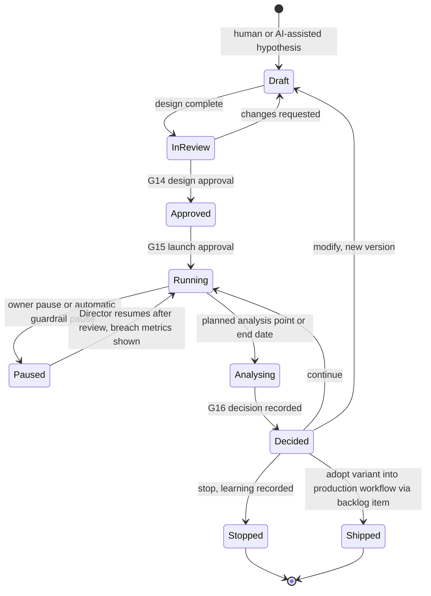
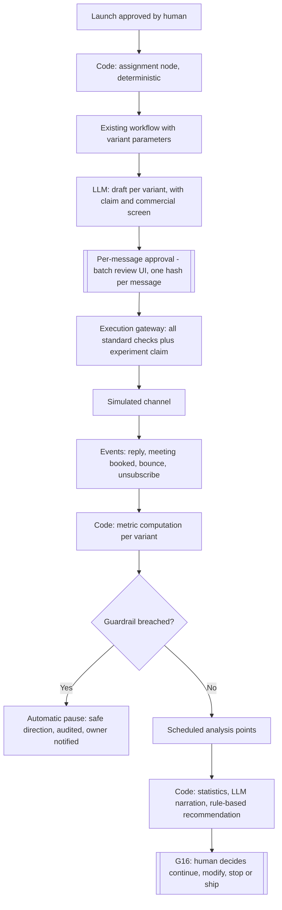

# GTM experimentation engine

**New file (Phase 3).** Design only, **[P]** unless tagged. The idea that GTM work proceeds through experiments comes from the interview summary **[F, via owner summary]** ([gtm-product-loop.md](gtm-product-loop.md) section 1). The mechanics below are ours.

## 1. Principles

1. **Humans choose strategy.** The system never decides which experiments to run, which audience to target, or when to launch, expand or stop one. Those are human-only decisions with no agent tool.
2. **AI assists, in bounded steps:** drafting hypotheses from backlog items and themes, drafting variant copy, sanity-checking design, computing results (code), narrating them and *recommending* continue/modify/stop.
3. **Experiments are configurations of existing workflows, not new agents.** A variant is a parameter set (message approach, rubric version, routing rule, timing) applied by the same workflow graph, executed by the same gateway.
4. **External execution is unchanged.** Every message in an experiment still needs human approval of its exact content (G5/G10); the gateway still enforces suppression, claims and caps.
5. **Honest statistics for a small business.** See section 7: at the assumed volumes most Corvane experiments cannot reach conventional significance quickly, and the engine must say so instead of declaring winners.

## 2. Lifecycle

## 3. Hypothesis and design

### Hypothesis template **[P]**
"We believe that **[change]** for **[audience]** will cause **[effect]** measured by **[primary metric]**, because **[reasoning or evidence, linked to themes/backlog]**. We will stop if **[guardrail]**."

### Design record
Hypothesis · linked backlog item/themes · type (inbound, outbound, pipeline, customer) · audience definition (below) · variants and allocation · primary metric and guardrail metrics with exact definitions and denominators · attribution window · minimum sample per arm · minimum and maximum runtime · pre-registered analysis points · stop rules · owner · approvals.

### Pre-registration
Metrics, analysis points, and stop rules are fixed at design approval and stored with a content hash. Changing them creates a new version that needs approval again. This limits "peeking" and metric shopping.

## 4. ICP and audience definition

- **ICP definition** is a versioned record (criteria and rubric), shared with qualification (U5). Qualification and experiments use the same definition, so they cannot drift apart.
- **Audience** = ICP filter + eligibility rules, evaluated over *resolved fields*. Rules: only fields that are fresh enough (expired data is not targeted on, see [data-model.md](data-model.md) section 7.3); exclude suppressed or do-not-contact contacts; exclude contacts in conflicting claims or other experiments; exclude active customers unless the experiment is about them; exclude accounts whose owner opted them out.
- **Snapshot:** the audience list is frozen at launch approval, stored, and shown to the approver (size, segment mix, sample members). Later enrolment of new matches requires a new approval.
- **Assignment:** deterministic hash of (experiment id, entity id) to variant, so repeated runs give the same result and assignment is auditable. Unit of randomisation is the contact for outbound, the lead for inbound, and the account when contacts at one account must not receive different treatments.
- **Holdout:** an optional no-change group within the audience.

## 5. Execution

- **Mutual exclusion:** an `experiment_claim` on each enrolled entity prevents it from being in two experiments that touch the same outcome. It composes with the standard outreach claim ([execution-architecture.md](execution-architecture.md) section 6).
- **Automatic pause** on guardrail breach (unsubscribe rate, bounce rate, complaint rate, domain circuit breaker open, reviewer rejection rate above threshold) is an A2 safe-direction action. Automatic *resume*, *expansion* and *stopping for success* do not exist.
- **Batch review:** reviewing 20 to 40 messages side by side is supported, but each message gets its own approval record bound to its own hash. Template-level pre-approval (approve once, personalise within rules) is **not** in MVP. It depends on the unresolved sequence-approval policy ([implementation-roadmap.md](implementation-roadmap.md) section 7, item 1).

## 6. Measurement

Metrics come from domain events attributed through assignment records; definitions are explicit with denominators (addressing problem P-13).

| Metric | Numerator / denominator | Typical use |
|---|---|---|
| Reply rate | Replies within window / delivered messages | Outbound |
| Positive reply rate | Interested or question replies / delivered | Outbound |
| Meeting-booked rate | Meetings booked within N days / audience members treated | Both |
| Qualified rate | Leads approved as qualified / genuine leads | Inbound |
| Lead-to-opportunity rate | Opportunities created / qualified leads | Inbound |
| Time to first human-approved response | Median hours | Inbound |
| Unsubscribe / bounce / complaint rate | Events / delivered | Guardrail |
| Reviewer edit rate | Edited / approved drafts | Guardrail (quality) |

Downstream outcomes (opportunity value, win rate) are too slow and sparse to be primary metrics in a company this size **[A]**; they are tracked descriptively.

## 7. Statistics at consultancy scale

Illustration, computed by script (two-sided α = 0.05, power 80%, normal approximation for two proportions; **[A]** volumes: ~200 outbound contacts per month, ~120 inbound enquiries per month):

| Baseline → target | Required per arm | Months at 200 outbound/month | Months at 120 inbound/month |
|---|---|---|---|
| 8% → 12% reply rate | 882 | 8.8 | 14.7 |
| 8% → 16% | 258 | 2.6 | 4.3 |
| 10% → 20% | 199 | 2.0 | 3.3 |
| 10% → 25% | 100 | 1.0 | 1.7 |
| 30% → 45% (e.g. lead→opportunity) | 163 | 1.6 | 2.7 |

Consequences **[P]**:
- Only large effects on frequent events are testable in weeks. Small expected effects are not.
- Results are labelled **conclusive**, **directional** (sample below plan; interval reported, no winner declared) or **inconclusive**.
- No peeking: formal comparisons at pre-registered analysis points only. A fixed-horizon test is used in MVP; sequential or Bayesian methods are later options with their own caveats.
- Report effect sizes with intervals, not just p-values. Small counts use exact methods. Multiple metrics get a stated primary metric to avoid cherry-picking.
- An A/A run (identical variants) is part of validating the engine: it should show roughly the nominal false-positive rate.
- Qualitative review of replies is part of analysis; it is the human learning channel.

### Recommendation rules (deterministic) **[P]**
| Condition | Recommendation |
|---|---|
| Guardrail breached | Stop (already auto-paused) |
| Below minimum sample, within max runtime | Continue |
| Minimum sample reached, interval excludes zero, effect meets minimum worthwhile size | Candidate to ship (human confirms; backlog item raised) |
| Minimum sample reached, interval includes zero, max runtime reached | Stop; record as inconclusive learning, or modify with a bigger expected effect |
| Effect in unexpected direction | Stop or modify; review for design flaw |

The LLM writes the narrative and surfaces caveats; it does not compute or change the recommendation.

## 8. Examples

### Inbound
| ID | Hypothesis | Variants | Primary metric | Guardrails |
|---|---|---|---|---|
| EX-IN-1 | A reply that proposes two concrete meeting slots lifts bookings versus an open-ended invitation | Specific slots / open invite | Meeting-booked rate within 7 days | Reviewer edit rate, unsubscribe |
| EX-IN-2 | Routing AI-service enquiries to a solution architect for the first call raises lead→opportunity rate | SA-led / BDR-led first call | Lead→opportunity rate | Time to first response, SA load |
| EX-IN-3 | An optional "timeline and budget range" field on the form improves qualification precision | With / without field | Qualification precision (agreement with later outcome) | Form completion rate |

### Outbound
| ID | Hypothesis | Variants | Primary metric | Guardrails |
|---|---|---|---|---|
| EX-OUT-1 | A message referencing a verified hiring signal gets more replies than a generic service-line message | Signal-based / generic | Positive reply rate | Unsubscribe, bounce, claim-check failures |
| EX-OUT-2 | Targeting Head of Data rather than CTO for data-engineering offers improves meetings | Persona A / persona B | Meeting-booked rate | Bounce, reviewer rejection |
| EX-OUT-3 | Adding a human-performed LinkedIn touch after email raises replies | Email only / email + LinkedIn task | Reply rate | Owner time per contact |

Pipeline and customer examples (later): timing of stalled-deal nudges; follow-up within 24 hours with summary versus standard.

Each example is feasible in the simulator, but only the large-effect ones are realistic in weeks at assumed volumes.

## 9. Learning library

Every decided experiment stores hypothesis, design hash, result snapshot, decision, rationale, and links to the backlog item and any workflow change. Learnings are searchable so the same idea is not retested blindly. A failed or inconclusive experiment is a first-class result.

## 10. What AI may and may not do

| Activity | AI | Human |
|---|---|---|
| Suggest hypotheses from themes and metrics | Yes, as drafts | Decides which to pursue |
| Define audience | May draft the filter | Approves audience and snapshot |
| Draft variant copy | Yes, with screens | Approves each message |
| Launch, resume, expand audience, change allocation | **No** | Yes |
| Pause on guardrail breach | Yes (safe direction) | Reviews |
| Compute results | Code only | Reviews |
| Recommend continue/modify/stop | Rule-based, narrated by LLM | Decides |
| Adopt winning variant into production workflow | No | Yes, through backlog and code review |

## 11. MVP scope

One end-to-end simulated experiment: a two-variant outbound or inbound message experiment with deterministic assignment, G14/G15/G16 gates, per-message approval through the gateway, event-based metrics, fixed-horizon analysis with the three result labels, guardrail auto-pause, and an A/A validation run. Everything else in section 9 and the "later" items below are deferred ([maturity-and-scope.md](maturity-and-scope.md) section 3).
