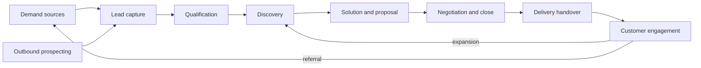

# GTM lifecycle for a technology consultancy

Describes how GTM generally works at a consultancy like Corvane, and where each of the four motions sits. The lifecycle is **[A]**, synthesised from common B2B services practice rather than from an authoritative source. Stage names in vendor material for IT services vary; one source lists Awareness Contact, Relationship Building, Business Case Development, RFP/Proposal, Contract Negotiation and Closed **[F, vendor blog]** ([Prospeo](https://prospeo.io/s/consulting-sales-pipeline), [Data-Mania](https://www.data-mania.com/blog/it-services-firm-gtm-benchmarks-2026/)). Corvane's stages below are my own simplification.

## 1. Lifecycle stages

| # | Stage | Entry | Exit | Owner **[A]** | Motion |
|---|---|---|---|---|---|
| 1 | Demand sources | n/a | Enquiry or target identified | Marketing, partners, referrals | Inbound, Outbound |
| 2 | Lead capture | Form, email, referral, event contact | Record in CRM, deduplicated | BDR, RevOps | Inbound |
| 3 | Qualification | New lead | Qualified, nurture or disqualified | BDR | Inbound |
| 4 | Discovery | Qualified lead and first meeting booked | Problem, budget, timeline, stakeholders understood | AE and solution architect | Pipeline |
| 5 | Solution and proposal | Discovery complete | Proposal and estimate sent | AE, SA, delivery lead | Pipeline |
| 6 | Negotiation and close | Proposal sent | Won or lost | AE, Sales Director, legal/finance | Pipeline |
| 7 | Delivery handover | Won | Project kicked off | AE to delivery lead | Customer |
| 8 | Customer engagement | Active customer | Renewal, expansion, churn | AE, delivery lead | Customer |

Outbound (stage 1 to 2) feeds the same pipeline. Pipeline management is a cross-cutting control over stages 4 to 6. Customer engagement loops back into discovery for expansion deals. This loop is why a shared data model matters: one account holds leads, opportunities, meetings and delivery history.

## 2. Activities per motion

### Inbound
Receive a web form, email or referral; check for an existing account or contact; research the company and person; judge fit (industry, size, service need, budget signal, timing, geography); route to the right AE; reply or book a call. Many enquiries are vendors selling to Corvane, recruiters, students or spam **[A]**.

### Outbound
Define target segments (ICP); build account lists; research each account (strategy, tech stack, hiring, news); pick a relevant offer and contact; write a personalised message; send; follow up; handle replies; hand responders to the inbound qualification path.

### Pipeline management
Keep CRM stages, values, close dates and next steps current; run weekly pipeline reviews; spot stalled or slipping deals; check for single-threaded relationships; forecast; decide what to escalate.

### Customer engagement
Prepare for meetings (history, stakeholders, open issues); run them; record notes and actions; send follow-ups; track delivery health; spot expansion triggers (new teams, new projects, renewals); coordinate with delivery.

## 3. Handoffs (where information is usually lost)

| Handoff | Typical loss **[A]** |
|---|---|
| Marketing/web form to BDR | Context in free-text fields never reaches the CRM; duplicate contacts |
| BDR to AE | Why the lead was qualified; what was already said |
| AE to solution architect | Customer's actual problem as told in discovery |
| AE to delivery lead | Promises made, assumptions in the estimate, stakeholder map |
| Delivery to AE | Customer sentiment, expansion signals, risks |

Handoffs are where agents add the most: they can write a structured, source-linked summary every time, even when people are busy. This is a hypothesis to test, not a finding.

## 4. Human decision points

These define the approval model carried into Phase 3. Anything below marked "human only" must never be done autonomously, per the project's principles.

| Decision | Who decides | Agent role |
|---|---|---|
| Is this a real, in-scope lead? | BDR | Recommend with evidence; auto-handle only the unambiguous cases (clear spam, exact duplicates) |
| Who owns the lead? | Rules, then Sales Director on conflict | Apply routing rules; propose on conflict |
| Send any external message | Human only | Draft only |
| Quote price, discount, or terms | Human only (Sales Director, finance, legal) | Never. May fetch rate-card facts for a human |
| Commit dates, staffing or scope | Human only (delivery lead) | Never |
| Change deal stage, value, close date, owner | Human approves (stage moves to Won/Lost always) | Propose with justification |
| Create new account/contact | Auto if no duplicate and high confidence; otherwise human | Check duplicates first |
| Pursue or drop a target account | AE | Rank and explain |
| Escalate a risky deal | Sales Director | Flag with evidence |
| Treat a customer as an expansion opportunity | AE and delivery lead | Surface signal and evidence |

## 5. Dependencies and risks across the lifecycle

- **Data dependency:** every motion needs clean account, contact and opportunity records. Duplicates and stale fields degrade all four.
- **Approval dependency:** all useful outputs end in a human action. If approvals are slow or ignored, the system produces a growing pile of unreviewed drafts, so queue health is a metric.
- **Information boundaries:** transcripts and emails contain confidential client information. Agent access must be scoped (see requirements NFR-SEC).
- **Capacity dependency:** a better inbound funnel is worthless if delivery cannot absorb the work. This is out of scope but noted as a limitation.
