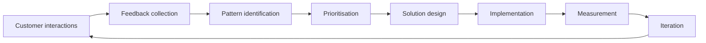
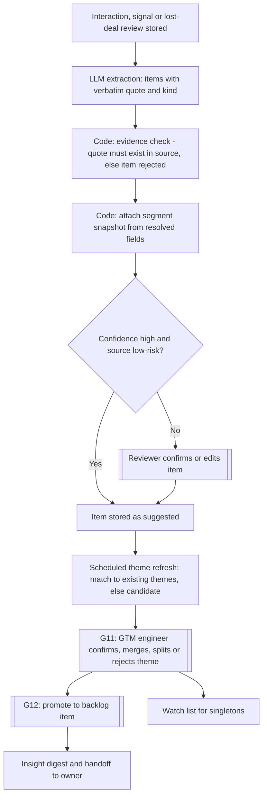
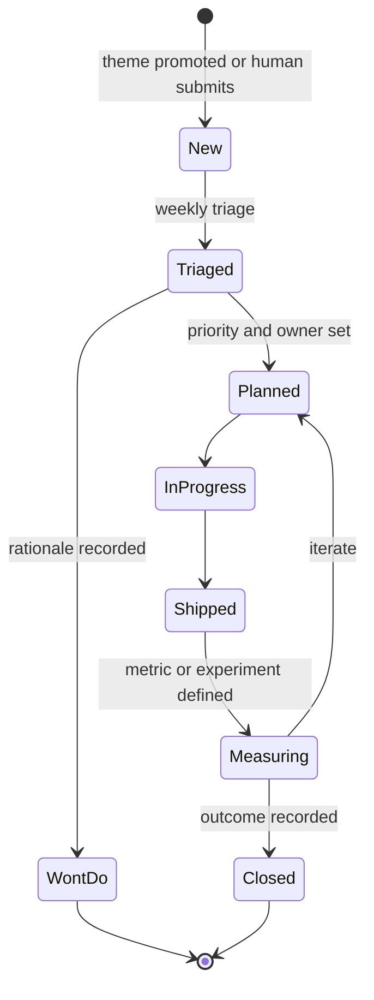

# GTM as a product function: feedback loop, feedback intelligence and backlog

**New file (Phase 3).** Evidence tags as elsewhere: **[F]** sourced, **[A]** assumption, **[P]** proposal.

## 1. Source and provenance

**[F, public listing]** A Focal podcast episode, "Why GTM Engineering is the Future | When to Hire Your First GTM Engineer | How to Treat GTM Like a Product | How Clay Scaled from PLG to Enterprise | Automate the Manual, Never the Important", features Yash Tekriwal, described as Clay's first GTM engineer and Head of Education; the listing is dated 2025-12-11 ([Castbox listing](https://castbox.fm/episode/Why-GTM-Engineering-is-the-Future-%7C-When-to-Hire-Your-First-GTM-Engineer-%7C-How-to-Treat-GTM-Like-a-Product-%7C-How-Clay-Scaled-from-PLG-to-Enterprise-%7C-Automate-the-Manual%2C-Never-the-Important-with-Yash-Tekriwal%2C-Head-of-Education-at-Clay-id6619998-id882567834)). The project brief spells the name "Techal"; the listing says "Tekriwal", and I use the listing's spelling.

**Provenance caveat:** no transcript reached me. Everything attributed to the interview below comes from the project owner's written summary of it plus the episode title. Where this document says "the interview says", read "the summary of the interview says". Nothing here describes Clay's internal systems, and nothing is meant to reproduce them.

## 2. Concepts taken from the interview (as summarised) **[F, via owner summary]**

1. GTM is an iterative **product development process**.
2. Sales, marketing and customer success teams are **sources of customer and market feedback**.
3. GTM Engineering **translates recurring problems and opportunities** into workflows, automations and experiments.
4. GTM organisations differ by **maturity** (early-stage, growing, scaling, mature). *That capabilities should match the stage is my inference, [P].*
5. **"Automate the manual, not the important."**

The *design* that follows (schemas, thresholds, gates, scoring, scope) is **[P]**.

## 3. The feedback loop

| Stage | In Corvane | System component | AI role | Human role |
|---|---|---|---|---|
| 1 Customer interactions | Calls, meetings, emails, delivery check-ins, signups, site events, lost deals | `interaction` and `buying_signal` tables (already in the data model) | None | Hold the conversations (see [maturity-and-scope.md](maturity-and-scope.md) section 4) |
| 2 Feedback collection | Extract objections, pain points, requests, competitor mentions, lost-deal reasons, each with a verbatim quote | Insight service: extraction step | LLM extracts with evidence span; suggestions only | Confirm low-confidence items; enter lost-deal reasons |
| 3 Pattern identification | Group items into recurring themes with counts and segment breakdown | Insight service: theme refresh | Proposes grouping and labels | Confirms, merges, splits or rejects themes (G11) |
| 4 Prioritisation | Turn confirmed themes into backlog items and rank them | Backlog service | Drafts item text; computes advisory score | Sets priority and status (G12) |
| 5 Solution design | Decide the fix: workflow change, data fix, content, experiment, offering feedback | Human-led with drafting help | Drafts options and an experiment hypothesis | Chooses the approach |
| 6 Implementation | Change a workflow or rubric, fix data, run an experiment, brief an offering owner | Orchestration, versioned workflow definitions, experiment service | None autonomously | Reviews and approves change; regression suite must pass |
| 7 Measurement | Compare outcomes with a baseline or control | Metrics, experiment analysis | Computes (code) and narrates (LLM) | Interprets |
| 8 Iteration | Close or reopen the backlog item; record the learning | Backlog outcome and learning library | Suggests next step | Decides |

Owners and artefacts per stage **[P]**:

| Stage | Owner role | Artefact |
|---|---|---|
| 1 Interactions | AE, BDR, delivery lead | `interaction` record, transcript |
| 2 Collection | System; BDR/AE confirm low-confidence items | `feedback_item` with verified quote |
| 3 Patterns | GTM Engineer | `feedback_theme` and G11 decision |
| 4 Prioritisation | GTM Engineer; Director for high impact | `backlog_item` and G12 decision |
| 5 Solution design | GTM Engineer with the affected team | Backlog decision note, experiment design or workflow change proposal |
| 6 Implementation | GTM Engineer | Versioned workflow/rubric change, or approved experiment |
| 7 Measurement | GTM Engineer | Metric snapshot, `experiment_result` |
| 8 Iteration | GTM Engineering lead | Backlog outcome and `learning` |

The "Notes" entries in the sources table below ("richest", "highest-value", "weak") are expectations **[A]**, not findings.

## 4. Two loops, one mechanism

- **Loop A, improve the GTM system itself** (workflows, rubrics, data sources, message approach). Consumer: the GTM Engineering team.
- **Loop B, feed the customer's voice to offering owners.** Corvane has no software product **[A]**, so the "product team" analogue is service-line leads, delivery leads and marketing. A theme such as "buyers keep asking for a fixed-price discovery phase" is routed to them.

Both use the same extraction, themes and backlog. A backlog item has a `target` field (gtm_system, service_line, delivery, marketing, other).

## 5. Customer feedback intelligence

### 5.1 Sources

| Source | Corvane equivalent **[A]** | MVP capture (all synthetic) | Notes |
|---|---|---|---|
| Sales calls | Discovery and proposal calls | Synthetic transcripts | Richest source of objections |
| Customer meetings | Steering and QBR meetings | Synthetic transcripts | Satisfaction, expansion, risk |
| Support interactions | Delivery-team requests, change requests, incident follow-ups | Later (simulated tickets) | Expected to reveal delivery pain **[A]** |
| Product signups | Webinar registrations, whitepaper downloads, free assessment signups | Later (simulated events) | Expected to show interest, not stated need **[A]** |
| Website activity | Page and content engagement | Later (simulated events) | Expected to be a weak, aggregate signal **[A]** |
| Lost opportunities | Structured lost-deal review | Human-entered form, AI-suggested tags | Highest-value feedback; low volume |
| Customer success conversations | Check-ins, renewals | Synthetic notes | Retention signals |
| Human interviews | Customer listening sessions run by people | Synthetic notes | **First-class source**; see section 7 |

### 5.2 Pipeline

### 5.3 Feedback item **[P]**

Each item has: kind (objection, pain point, request, competitor mention, lost reason, praise, risk), topic from a controlled taxonomy (plus free-text label), verbatim quote with its location in the source, speaker role, sentiment, account and segment snapshot (service line, industry, size band, deal size band), source type, extraction run, confidence, and review status. **The quote is mandatory and checked by code.** An item whose quote is not found in the source is discarded (this guards against hallucinated feedback).

### 5.4 Recurring patterns, not individual requests

Rules **[A]** (thresholds are starting values to calibrate on the synthetic corpus):

1. A theme counts **distinct accounts**, not mentions. Ten mentions from one account is one account.
2. A theme is "recurring" at ≥3 distinct accounts and ≥2 distinct sources or reporters in a rolling 90 days. Below that it sits on a **watch list**.
3. Counts never rank anything alone. Reports show count, distinct accounts, segment mix, revenue at stake (sum of linked opportunity values, labelled as computed), recency trend, **and counter-evidence** (accounts for whom the opposite was true).
4. A theme is **not a requirement.** Promotion needs a human decision with a stated rationale. A single request from a strategic account may still be acted on by a human, but is recorded as such, not as a pattern.
5. Strategic overrides are allowed and recorded, so the dataset shows when the human went against the counts.

### 5.5 Known biases **[A]**

| Bias | Mitigation |
|---|---|
| Loud-account effect | Distinct-account counting |
| Source skew (lost deals have few interactions; won deals many) | Report per source; do not pool silently |
| Extraction over-reading | Verbatim-quote rule, sampled review, extraction evals |
| Survivorship (we only hear from engaged customers) | Show coverage: share of accounts with any feedback; flag silent segments |
| Recency | Trend shown alongside totals |
| Taxonomy lock-in | Free-text label and "other" kept; taxonomy reviewed quarterly |
| Confusing stated with underlying need | Human theme review; links to raw quotes |

### 5.6 Privacy and scope **[P]**

Feedback work is the one place where analysis spans accounts. It runs under a separate **portfolio-read** scope for the insight service only. Account agents stay account-scoped (NFR-SEC-03 unchanged). Theme reports show account names and quotes only to roles allowed to see those accounts; others see anonymised aggregates. All data in this repository is synthetic.

### 5.7 Handoff to owners

Insight digest (weekly to the GTM Engineering team, monthly to service-line leads) and ad hoc handoffs. Each handoff has a status (sent, acknowledged, actioned, declined with reason) so the loop is visibly closed or visibly open. Telling customers what changed is a human act.

## 6. GTM improvement backlog

### 6.1 Fields

| Field | Notes |
|---|---|
| Title, problem or opportunity | One of each type; plain language |
| Type | workflow, data, rubric/scoring, message/content, experiment, enablement, offering feedback, process |
| Target | gtm_system, service_line, delivery, marketing, other |
| Source | Theme ids, lost-deal reviews, human submissions, metric anomalies |
| Occurrences, distinct accounts | Computed by system (system-owned) |
| Affected teams | BDR, AE, SA, delivery, RevOps, Director |
| Potential business impact | Low/medium/high with rationale (human-owned) |
| Revenue or deal-size relevance | Sum of linked opportunity amounts and count of lost deals (computed, labelled) |
| Implementation effort | S/M/L with rationale (human, may be drafted by AI) |
| Advisory score | Computed (section 6.2) |
| Priority | Human-owned |
| Status | new, triaged, planned, in progress, shipped, measuring, closed, won't do |
| Outcome | What changed and the measured result, with metric references |
| Links | Experiments, workflow versions, handoffs |

### 6.2 Advisory score **[P]**

To stay consistent with [use-case-prioritisation.md](use-case-prioritisation.md), the score reuses a weighted-criteria approach: reach (distinct accounts), revenue relevance, strategic fit (human input), evidence strength (sources, quotes, counter-evidence), effort (inverse), and risk. The score **orders the triage list but never sets priority**. Priority is a human field, and any difference between the two is visible.

### 6.3 Lifecycle and operating rhythm

Weekly 30-minute triage by the GTM Engineering team; monthly review with the Director **[A]**. Items have an owner and an outcome field; "won't do" keeps its reason so the same request is not re-argued.

### 6.4 Organisation model **[P]**

A **centralised GTM Engineering team** (1 to 2 people **[A]**) owns the backlog and the shared services. Sales, Delivery, Marketing and RevOps submit and are consulted. This fits a ~12-person GTM organisation. Embedded engineers per team, platform/enablement groups and formal governance boards are explicitly not modelled ([maturity-and-scope.md](maturity-and-scope.md) section 2).

| Decision | Decides | Consulted |
|---|---|---|
| Confirm a theme | GTM engineer | Owner of affected area |
| Set backlog priority | GTM engineering lead; Director for high-impact | AEs, delivery lead |
| Change a production workflow or rubric | GTM engineer (code review + regression suite) | RevOps, affected team |
| Launch an experiment | Director (G15) | GTM engineer, AE lead |
| Act on an offering-level theme | Service-line lead | Director |
