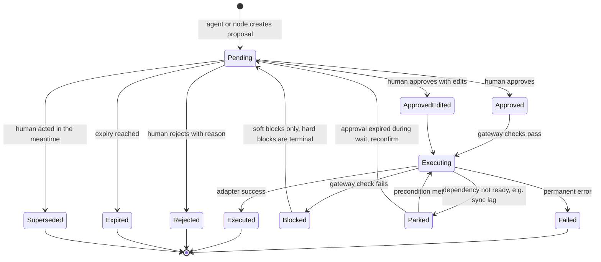

# Human oversight

**Modified (Phase 3):** expands the earlier seed rules. Design only, **[P]**. SLAs and thresholds are **[A]**.

## 1. Autonomy levels

| Level | Meaning | Allowed examples |
|---|---|---|
| A0 Observe | Read and analyse only | Meeting briefs, digests, research briefs (internal) |
| A1 Self-maintain | Write agent-owned data and system flags | `ai_*` fields, agent state, stall flags, enrichment within cost cap |
| A2 Safe-direction automatic | Actions that can only reduce risk or outreach, fully audited | Add suppression on unsubscribe/bounce, stop a sequence on reply, link exact-match duplicates, archive high-confidence spam |
| A3 Propose | Anything else: creates a proposal needing a human decision | CRM creates, field changes to human-owned data, merges, drafts, tasks, sequence steps |
| A4 Human-only | No agent path exists | Pricing, discounts, terms, scope/date commitments, Won/Lost, sending without approval |

Everything not listed at A0 to A2 is A3 or A4 by default (deny by default).

## 2. Gate catalogue

| Gate | Triggered by | Approver role | SLA to escalate | Expiry | Evidence shown | Edit allowed |
|---|---|---|---|---|---|---|
| G1 Match confirmation | Possible duplicate | BDR / RevOps | 1 business day | 14 days, then stays unlinked | Both records, scores, shared keys | Choose same/distinct |
| G2 Merge | Confirmed same | RevOps | 2 days | 14 days | Field-by-field diff, undo note | Pick survivor values |
| G3 Lead disposition | Qualification result | BDR | 4 business hours | 3 days | Score, rubric breakdown, sources, route | Change score, owner |
| G4 CRM create/update | Account/contact/opportunity creation | BDR/AE | 1 day | 7 days | Resolved fields with provenance | Edit any field |
| G5 Message approval | Draft reply, follow-up, outreach | Owning AE/BDR | 1 day | 3 days | Draft, source-linked claims, recipient, checks status | Edit text (new hash) |
| G6 Human-field change | Stage, amount, close date, forecast category | AE; Director for Won/Lost | 1 day | 7 days | Rationale, evidence, current value | Edit |
| G7 Task/next action | Agent recommendation | Owner | 2 days | 5 days | Evidence, confidence | Edit, assign |
| G8 Opportunity from signal | Expansion/risk signal | AE + delivery lead | 3 days | 14 days | Quotes/evidence | Edit |
| G9 Escalation review | Overdue gate, risk flag | Director | 1 day | n/a | Queue age, deal data | Reassign |
| G10 Sequence step | Due sequence step | Owner | Before due time | Step due time + 30 min grace | Draft, current checks | Edit, skip, pause |

Rule: **no gate approver may be the sole authority over pricing or commitments**; those are A4 and have no gate in the system at all.

## 3. Proposal lifecycle

Approvals bind to a payload hash and role. Edits create a new hash and the approval applies to the final version only.

## 4. Preventing automation bias (risk R-09)

- Evidence and confidence displayed beside every recommendation, with the "what would change this" line.
- Seeded **canary proposals** with known errors in test environments to measure whether reviewers catch them (evaluation only).
- Metrics: approve-without-edit rate by reviewer and type, median review time, share approved in under 5 seconds **[A]**. Suspicious patterns are reported on the dashboard.
- Random audit sampling of auto-handled items (archived spam, auto-links).
- High-impact types (merge, hierarchy change) require an explicit confirmation step.

## 5. Queue health (risk R-10)

Queue age per gate, overdue count, escalation count, expiry rate, and throughput are first-class dashboard metrics. If expiry rate exceeds a threshold **[A]**, the system reduces proposal volume (batches, raises thresholds) before overwhelming reviewers.

## 6. Feedback capture

Reason codes on every decision ([account-agents.md](account-agents.md) section 9). Edits retain the diff. Rejections feed regression candidates.

## 7. Reviewer roles and access

| Role | Can approve | Can see |
|---|---|---|
| BDR | G1, G3, G4 (leads, contacts), G5 on own leads | Own leads/accounts |
| AE | G4–G8 for owned accounts | Owned accounts |
| Delivery lead | G8 (with AE) | Customer accounts they serve |
| RevOps | G1, G2, G4 (all), field policy changes | All records, no commercial content |
| Director | G6 Won/Lost, G9, any override | All |

Role checks are enforced in the approval service. Changing field-ownership policy is itself an audited, RevOps-only action.

## 8. Gates added for the GTM product loop

Design only, **[P]**; SLAs and expiries **[A]**. A **GTM Engineer** role is added (central team of 1 to 2).

| Gate | Triggered by | Approver | SLA to escalate | Expiry | Evidence shown | Edit allowed |
|---|---|---|---|---|---|---|
| G11 Theme confirmation | New or changed candidate theme | GTM Engineer | 1 week (weekly triage) | 30 days, stays candidate | Sample raw quotes first, then summary; distinct accounts; counter-evidence | Merge, split, relabel |
| G12 Backlog priority and promotion | Confirmed theme or human submission | GTM Engineer; Director for high impact | 1 week | None | Advisory score and components; revenue relevance; effort | Set priority, status, owner |
| G13 Insight handoff | Digest or ad hoc handoff | GTM Engineer | 1 week | n/a | Aggregated, role-appropriate evidence | Edit text, recipients |
| G14 Experiment design | Draft experiment | Director (or AE lead) with GTM Engineer | 1 week | 30 days | Hypothesis, audience definition, variants, metrics, sample-size feasibility, stop rules | Edit design (new version) |
| G15 Experiment launch | Approved design | Director | 3 business days | 14 days | Frozen audience snapshot, variant content, guardrails | Approve, reject, edit audience (new snapshot) |
| G16 Experiment decision | Analysis point | GTM Engineer; Director for ship decisions | 1 week | None | Counts, intervals, label, caveats, rule-based recommendation | Continue, modify, stop, ship |

Rules:
- G15 and G16 have **no agent path**. There is no tool to launch, resume, expand, reallocate or stop-for-success. Only the automatic guardrail pause (A2) exists.
- Per-message approvals (G5, G10) still apply to every external message in an experiment.
- Reviewers confirming a theme see raw quotes before AI summaries, and confirming without opening evidence is sampled for a reason prompt (see [maturity-and-scope.md](maturity-and-scope.md) section 4.3).
- Lost-deal reasons are entered by humans; the AI may only suggest tags, shown separately.
- **Human-led activities** (debrief calls, customer listening sessions, negotiation, escalations, strategy) have no automated substitute; see [maturity-and-scope.md](maturity-and-scope.md) section 4.2.

Role additions: GTM Engineer approves G11 to G13 and participates in G14 and G16; Director approves G15; AE lead can approve G14.

## 9. Review amendments

*Supersede earlier text where they differ.*

### 9.1 Autonomy levels renamed A0 to A4, and A1/A2 tightened
"L0 to L4" is now **A0 to A4** to avoid clashing with architecture layers L1 to L7. Wherever earlier text says "L2 safe-direction", read **A2**.

- **A2 safe-direction automatic** now means only actions that reduce outreach or risk and are easy to audit: adding suppression on a hard signal, stopping a sequence, claiming or releasing exclusion, experiment guardrail auto-pause, circuit-breaker opening.
- **Spam is moved to A1 and made reversible:** a suspected-spam enquiry is **held**, not archived or deleted, and appears in a daily digest to the BDR with a one-click release. It is never held automatically if the sender matches an existing contact, a customer domain or an open thread. The evaluation sets a target for real leads wrongly held (scenario S50).
- **Exact-match linking** (A1) uses only: identical normalised email to an existing contact. Role/shared mailboxes (info@, sales@) and free-mail domains are excluded, and a link never merges accounts. Anything else is a match proposal (G1). Links are logged for undo.

### 9.2 Override rules
No human override is ungated. Each is a recorded decision with a reason.

| Override | Who | Evidence and audit |
|---|---|---|
| Exceed the account touch cap | Owning AE; Director above twice the cap | Reason; shown in context; audited |
| Release the human-touch lock | The contact's owner | Reason; audited |
| Reset an opened domain circuit breaker | Director with RevOps | Breach metrics displayed; audited |
| Resume an auto-paused experiment | Director | Breach metrics displayed; new approval record |
| **Lift a suppression** | RevOps and Director | Evidence of contact-initiated opt-in is mandatory; never by an agent; do-not-contact is not liftable without it |
| Mark a flagged passage "not a commitment" | AE or above | Reason; discount/price terms cannot be released |
| "Director override" generally | Director | Limited to the listed overrides; it cannot lift suppression or DNC without evidence |

### 9.3 Separation of duties
The approver must differ from the proposer or owner for G6, G12, G14 and G16, except the Director, whose self-approvals are flagged for audit sampling. A delegated reviewer must hold the required role, and delegation is audited.

### 9.4 Unified gate-role matrix

| Role | Gates |
|---|---|
| BDR | G1, G3 and G4 (leads, contacts) for own leads; G5 on own leads |
| AE | G3, G4 to G8 and G10 for owned accounts; mark "not a commitment" |
| Delivery lead | G8 with AE |
| RevOps | G1, G2, G4 (data-only fields, no commercial content), field-policy changes; suppression lift with Director |
| GTM Engineer | G11, G12 (non-high-impact), G13; participates in G14, G16 |
| Director | G6 (stage/value/close), G9, G12 (high impact), G14, G15, G16 (ship), overrides in 9.2 |

Won/Lost are human-initiated in the CRM and are **not proposable by an agent**; G6 records the human decision. A closed-lost event creates a lost-deal review task.

### 9.5 Proposal lifecycle corrections
`Blocked` returns to `Pending` only for **soft** blocks. Hard blocks (suppression, do-not-contact) are terminal. The `Parked → Executing` edge checks approval expiry explicitly. The enum is in [data-model.md](data-model.md) section 11.1.

### 9.6 Insight service principal
The insight and experiment services run under their own **service principal** with the portfolio-read profile; every call is logged to `tool_call`. The evaluation harness profile excludes it. Narratives are generated from anonymised inputs, with names rejoined by role afterwards. Theme definitions used as prompt context are human-confirmed text only.
