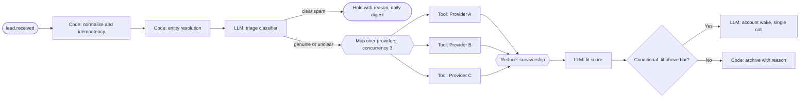

# Orchestration architecture

**New file (Phase 3).** Design only, all **[P]** unless tagged. The graph-with-typed-nodes idea comes from the talk as summarised by the project owner **[F, via owner summary]**; the runtime design here is ours and is not a claim about any vendor's implementation.

## 1. What the orchestrator must do

Coordinate multi-step GTM processes across systems that are slow, rate-limited and eventually consistent, while remaining auditable and safe to retry. Requirements traced: NFR-REL-01 to -04, NFR-OBS-01, FR-PLT-06, FR-PLT-08.

## 2. Graph model

A **workflow** is a directed acyclic graph of **nodes** (loops are expressed as re-triggered runs, never cycles, to keep runs bounded and traceable). A **run** is one execution of a workflow for a trigger. Each node execution is a durable `run_step` row.

| Node type | Purpose | Deterministic? | Examples |
|---|---|---|---|
| **Trigger** | Start a run from an event | Yes | webhook received, `reply.received`, `meeting.booked` |
| **Schedule** | Start a run on time | Yes | heartbeat due, daily hygiene scan, digest |
| **Code** | Pure logic on data | Yes | normalise payload, compute stall flags, survivorship, suppression check |
| **Tool** | Call an adapter or service | Yes (side effects idempotent) | provider lookup, CRM read, create task |
| **Conditional** | Branch on a computed value | Yes | duplicate found? confidence above bar? |
| **LLM** | One bounded model call with schema-validated output | No | spam classifier, fit scoring, draft email |
| **Agent** | Bounded tool-using loop (step and cost limited) | No | research agent, account agent wake |
| **Map** | Fan-out: run a sub-graph per item, concurrency-limited | Yes (structure) | per provider, per account, per contact |
| **Reduce** | Fan-in: combine mapped results with a deterministic function | Yes | survivorship over provider results |
| **Wait** | Pause until time, event or predicate | Yes | wait for CRM contact visibility, wait for approval |
| **Approval** | A Wait whose condition is a human decision on a proposal | Yes | gate before execution |

The talk, as summarised, lists agent, tool, conditional, code and map/reduce nodes. We add Trigger, Schedule, Wait, Approval and LLM as explicit types because waiting, human gates and single-shot LLM calls are central to our safety and cost goals.

## 3. Deterministic, LLM or agent?

Rule **[P]**: choose the *least* powerful option that works. An agent node needs a written justification.

| Operation | Choice | Justification |
|---|---|---|
| Payload parsing, validation, idempotency check | Code | Fully specified |
| Exact/fuzzy matching, blocking, scoring | Code | Cheap, testable; LLM only as optional tiebreaker for ambiguous pairs (still produces a proposal) |
| Provider calls, waterfall ordering, survivorship | Code and Tool | Deterministic rules over observations; the point is explainable provenance |
| Stall detection, hygiene checks, digest numbers | Code (SQL) | Must be exactly right |
| Spam/vendor/recruiter classification | LLM (single call) | Unstructured text, structured output |
| Fit scoring against ICP rubric | LLM with code-enforced hard constraints | Judgement plus rules |
| Extracting facts from emails or transcripts | LLM (single call) | Unstructured input |
| Draft reply, follow-up, outreach | LLM (single call) | Generation; human-approved |
| Weekly digest commentary | LLM (single call) over computed numbers | Numbers never generated by the model |
| Company research when the sources are unknown in advance | **Agent** | Path depends on findings: search, read, follow links, stop when confident |
| Account next-best-action reasoning | **LLM first; agent only if context assembly needs to be dynamic** | Starts as one call over a pre-assembled context pack. Escalates to an agent loop only if evaluation shows missing context is the main error |
| Merging records, sending, stage/price changes | **Never autonomous** | Human-only or proposal-gated |

Consequence: in the MVP only the research node and (optionally) the account-agent wake are agent nodes.

## 4. Triggers, schedules and the event bus

Events are rows in `domain_event` written in the same transaction as the change that caused them (the **outbox pattern**), so no change is lost. Delivery to consumers is at-least-once; duplicates are removed by dedupe keys and idempotent consumers (section 12). A dispatcher reads new events and enqueues jobs by matching **subscriptions** (event type → workflow). Duplicate events (same `dedupe_key`) are dropped.

| Trigger class | Examples | Mechanism |
|---|---|---|
| Inbound webhook | form submitted, calendar event, reply received | HTTP endpoint writes event with idempotency key |
| Domain event | `opportunity.stage_changed`, `proposal.approved`, `signal.detected` | Outbox, then dispatcher |
| Schedule | heartbeat due, nightly hygiene, weekly digest | Scheduler loop enqueues from a `schedule` table (next_run_at); no external cron |
| Manual | "review this account now", replay | API call by a user |

Burst control: events for the same account within a short window (default 60 seconds **[A]**) are **coalesced** into one account wake.

## 5. Execution semantics

### 5.1 Durable runs and queue
Jobs live in a Postgres table and are claimed by workers with row locking (`FOR UPDATE SKIP LOCKED`), so no separate broker is needed. A run's state advances node by node; every transition is committed with its event. A worker crash leaves a claimed job whose lease expires, and another worker resumes at the first incomplete node.

### 5.2 Delivery guarantee and idempotency
Execution is **at-least-once**, made **effectively-once** by idempotent steps:

- Each side-effecting node derives an idempotency key from `(workflow, trigger dedupe_key, node_id, item key)`, deliberately excluding the attempt number.
- Adapters pass the key to the target system if it supports one (the simulators do). Otherwise the adapter first looks up the external reference stored from any earlier attempt.
- The `execution` table has a unique constraint on the key, so a repeated attempt returns the earlier result.
- Inbound events and leads carry their own idempotency keys (FR-PLT-06).

### 5.3 Retry policy

| Node class | Max attempts | Backoff | Retry on | Do not retry on |
|---|---|---|---|---|
| Provider/CRM/outreach tool | 5 | exponential with jitter, 2s to 60s | timeout, 429, 5xx, connection errors | 4xx validation, auth, policy denial |
| LLM | 2 (one repair retry with the validation error) | short | transient API error, schema-invalid output | refusal, budget exceeded |
| Agent | 1 whole-loop retry | n/a | transient infrastructure failure | step or cost cap reached |
| Code | 0 | n/a | n/a (bugs should fail loudly) | all |

### 5.4 Timeouts and budgets
Every node has a timeout; every run has a wall-clock limit and a cost cap (NFR-REL-04). Exceeding a cap ends the run in `budget_exceeded` and creates a "needs attention" item. It is never silently truncated.

### 5.5 Failure handling

| Failure | Handling |
|---|---|
| Transient tool error | Retry per policy |
| Permanent tool error | Mark step failed, run goes to `needs_attention` with the error and a one-click retry |
| LLM invalid output twice | Fall back to a human-review proposal containing the raw input and the failure note |
| Dependency not ready (out of sync) | **Park**, not fail (see section 7) |
| Partial fan-out failure | Reduce node receives per-item results including failures; workflow rule decides proceed-with-partial or fail (waterfall proceeds with the sources that succeeded and marks gaps `unknown`) |
| Compensation | Executions are small and idempotent. Where an earlier step must be undone (a contact created in the CRM by an execution that later steps cannot complete), a compensating proposal is raised for a human. No automatic deletion |
| Poison event | After N failures **[A]** the event moves to a dead-letter state and alerts |

### 5.6 Event logging
Each run step writes a trace row and, for state changes, an audit event. Together they let any outcome be replayed and explained (NFR-AUD-01). Recorded model responses attach to the step so a run can be replayed offline.

## 6. Parallelism: fan-out and fan-in



Rules: map concurrency is limited per provider (rate limits); a map's total time is bounded by its slowest item or a timeout; reduce nodes are deterministic so identical inputs give identical outputs, which is what makes regression tests meaningful.

## 7. The CRM-to-outreach synchronisation problem

**Problem [F, via owner summary]:** a contact created in the CRM is not immediately available in another system (for example an outreach or sequencing tool). A workflow that tries to use it straight away fails or, worse, creates a duplicate.

**Our simulator reproduces it:** the outreach-tool simulator makes a CRM contact visible only after a random delay (default 5 to 120 seconds, occasionally several minutes **[A]**), and may need an explicit import call. It can also be configured to drop a sync entirely.

### 7.1 Design: explicit sync state

Each `(contact, target system)` pair has a `sync_state`: `unknown → pending → visible → enrolled`, plus `failed` and `timed_out`. The execution step never assumes visibility; it depends on a **precondition node**.

```mermaid
sequenceDiagram
    autonumber
    participant H as Human reviewer
    participant O as Orchestrator
    participant G as Execution gateway
    participant C as Simulated CRM
    participant X as Outreach tool (sim)
    H->>O: approve proposal (create contact and send intro)
    O->>G: execute step 1: create contact in CRM
    G->>C: create (idempotency key)
    C-->>G: contact id crm_123
    G->>O: step done; sync_state(outreach)=pending
    O->>O: Wait node: until visible in outreach tool
    loop poll with backoff 5s, 10s, 20s ... cap 60s, deadline 30 min
        O->>X: lookup by external key crm_123
        X-->>O: not found
    end
    C-->>X: (eventual) sync completes
    O->>X: lookup by external key
    X-->>O: found
    O->>O: re-check preconditions: suppression, claim, approval still valid
    O->>G: execute step 2: enrol or send
    G->>X: enrol (idempotency key)
    X-->>G: ok
    G->>O: done; audit event
```

### 7.2 Rules

1. **Look up before create.** The outreach adapter never creates a contact in the target system as a workaround for "not found" unless the lookup by stable external key and by email both return nothing *and* an explicit import mode is configured. This prevents duplicates.
2. **Prefer events to polling.** If the simulator emits a `contact.synced` webhook, the Wait node resumes on the event. Polling with backoff is the fallback. Both exist because the talk describes waiting and polling, and because the evaluation can compare them.
3. **Bounded wait.** After the deadline the run is **parked** as `sync_timeout` and raises a needs-attention item. It does not retry forever and does not fail the approved proposal permanently.
4. **Approval validity.** An approval is bound to the proposal's payload hash and has an expiry. If a wait outlasts the expiry, the proposal returns to a re-confirmation state rather than executing on stale consent.
5. **Re-check after waiting.** Suppression, outreach claims and contact status are re-evaluated after the wait and immediately before sending, because the world may have changed (the contact may have unsubscribed during the wait).
6. **Visibility of state.** The dashboard shows `pending` and `timed_out` syncs so a person can see why something has not happened.
7. **Duplicate protection.** Idempotency keys on create and enrol mean a retry after an ambiguous failure (timeout with unknown outcome) cannot double-create or double-send.

Failure cases tested in the evaluation: sync never completes; sync completes twice; the CRM create times out but actually succeeded; the contact is suppressed during the wait; approval expires during the wait; outreach tool returns a different record with the same email.

## 8. Workflow definition and versioning

Workflows are declared as versioned files (YAML or JSON) listing nodes, edges, retry policies and budgets, loaded at start-up. Each run records the workflow version, prompt versions and model ids. A graph change is a code review and triggers the regression suite (FR-EVL-02). No visual editor in the MVP.

## 9. n8n

Optional. If used, it sits at the edge only: receiving webhooks and forwarding them to our endpoint, scheduled pings, and notification fan-out (e.g. email or chat alert when a proposal is waiting). The system must run end to end without it (AD-08). Reasons for not placing core orchestration in n8n are in [technology-decisions.md](technology-decisions.md) section 2.

## 10. Workflows added for the GTM product loop

All use the existing node types; none needs a new one. **[P]**

| Workflow | Trigger | Main nodes | Technique split |
|---|---|---|---|
| `feedback-extract` | `interaction.stored`, `lost_deal_review.saved`, `signal.detected` | Code (fetch), LLM (extract, small model), Code (verify quote, attach segment snapshot), Conditional (confidence/source risk), Approval (when needed) | One LLM call; verification is code |
| `theme-refresh` | Schedule (weekly) and on demand | Map over new items, Code (blocking by topic/trigram), LLM (compare to theme definitions, batched), Reduce (assign or create candidate), Code (recompute counts) | LLM only for ambiguous matches |
| `insight-digest` | Schedule (weekly) | Code (queries, numbers), LLM (narrative over computed figures), Tool (notification) | Numbers never generated by the model |
| `experiment-assign` | `experiment.launched` only (frozen audience snapshot) | Code (eligibility over fresh resolved fields, deterministic hash), Code (claim) | Fully deterministic |
| `experiment-monitor` | Schedule (hourly/daily) and on outcome events | Code (metrics, guardrail check), Conditional, Tool (auto-pause), Tool (notify) | Fully deterministic |
| `experiment-analyse` | Pre-registered analysis points | Code (statistics), LLM (narrative), Code (rule-based recommendation), Approval (G16) | LLM never computes or changes the recommendation |

Backlog scoring is a code step triggered by theme or item changes. Experiment *variant execution* is the existing outbound or inbound workflow with variant parameters injected at the assignment node, not a separate graph.

## 11. Canonical event catalogue (added after the Phase 3 review)

One name per event. Earlier names `outreach.replied`, `action.executed`, `action.failed`, `contact.synced` are retired in favour of the names below. **[P]**

| Event | Producer | Consumers | Table |
|---|---|---|---|
| `lead.received` | Webhook endpoint | Inbound intake graph | `lead` |
| `lead.qualified` | Inbound graph after G3 | Account-agent wake, dashboard | `lead` |
| `interaction.stored` | Ingestion | `feedback-extract`, change detector | `interaction` |
| `reply.received` | Reply router | Sequence stop, account-agent wake | `interaction` |
| `meeting.booked` | Calendar webhook | Sequence stop, brief workflow, wake | `interaction` |
| `transcript.ready` | Transcript ingestion | Meeting assistant | `transcript` |
| `signal.detected` | Signal ingestion | Wake, `feedback-extract` | `buying_signal` |
| `opportunity.created`, `opportunity.stage_changed`, `opportunity.closed_lost` | CRM adapter (human-approved write or CRM-sim change) | Pipeline monitor, wake; closed-lost also creates a lost-deal review task | `opportunity`, `stage_history` |
| `deal.flagged` | Pipeline monitor (U7) | Wake (consumes the flag), owner notification | `opportunity.is_stalled` |
| `lost_deal_review.saved` | Reviewer UI | `feedback-extract` | `lost_deal_review` |
| `proposal.created`, `.approved`, `.rejected`, `.expired`, `.superseded` | Proposal service | Orchestration (resumes waits), dashboard | `proposal`, `approval_decision` |
| `execution.completed`, `execution.failed` | Gateway | Orchestration, wake, dashboard | `execution` |
| `sync.contact_visible` | Outreach-sim webhook | Wait-node resume | `sync_state` |
| `suppression.added` | Reply router, human | Gateway, wake | `suppression` |
| `sequence.stopped` | Reply router, rules | Wake | `outreach_claim` |
| `breaker.opened` | Gateway monitor | Notification | `sending_domain_stats` |
| `enrichment.requested`, `enrichment.completed` | Agent tool or workflow; waterfall | Waterfall, wake | `enrichment_request` |
| `feedback.captured` | `feedback-extract` | Wake | `feedback_item` |
| `theme.updated` | `theme-refresh` | Backlog scoring | `feedback_theme` |
| `backlog.status_changed` | Backlog service | Dashboard, handoff | `backlog_item` |
| `experiment.launched` | G15 decision | `experiment-assign` (frozen audience only) | `experiment` |
| `experiment.guardrail_breached` | `experiment-monitor` | Auto-pause step in the same workflow, notification | `experiment`, event |
| `experiment.paused` | Monitor or owner | Gateway state check, notification | `experiment` |
| `experiment.result_ready` | `experiment-analyse` | G16 queue | `experiment_result` |
| `heartbeat.due` | Scheduler | Account wake, pipeline scan | `schedule` |
| `job.dead` | Runner | Needs-attention queue | `job` |

## 12. Delivery, ordering and concurrency rules (added after the review)

1. **At-least-once delivery, idempotent consumers.** The statement in section 4 that nothing is "announced twice" is corrected: the outbox guarantees no change is lost; duplicates are removed by `dedupe_key` and by a unique (`subscription`, `event`) dispatch row.
2. **Gap-safe dispatch.** The dispatcher claims `pending` rows in `dispatch` with `SKIP LOCKED`; it never advances a cursor over `seq`, so a transaction committing out of order cannot be skipped.
3. **Ordering:** no global order is promised. Consumers compare an event's `source_version` (or `occurred_at` when no version exists) with the entity's last applied version; stale events are recorded as `ignored_stale`, not applied (scenario S30).
4. **Per-account serialisation:** workflow runs that write account-scoped state take the `account_lease`; read-only runs do not. Suppression inserts are atomic row inserts and are allowed regardless of the lease (safe direction).
5. **Coalescing and lifecycle filtering belong to the dispatcher**, keyed by wake target (the account, or a provisional lead key until entity resolution assigns an account). Events for dormant or archived accounts wake the agent only if they are reactivation triggers. When the lease is held, further events set a "dirty" flag on the running wake instead of re-queuing indefinitely; the running wake reschedules itself once if dirty.
6. **Zombie protection:** the lease carries a fencing token (the state version); writes with a stale token fail. Proposals get an idempotency key (`run_id`, action index) so a zombie cannot create duplicates.
7. **One scheduling source:** `schedule`. Heartbeat tables elsewhere in the docs mean rows in `schedule`.
8. **Dead letters:** a `dispatch` or `job` becomes `dead` after N attempts **[A]** and appears in the needs-attention queue.

## 13. Execution-boundary rules (added after the review)

1. **Adapter classes.** Read adapters and named internal services (notify, create draft, auto-pause) may be called by Tool nodes. **Side-effecting adapters** (CRM write, outreach enrol, send) accept calls only with a **gateway-issued execution token** scoped to one proposal, payload hash, adapter and short expiry. A workflow lint rejects graphs whose Tool nodes name a side-effecting adapter directly (scenario S52).
2. **Who waits.** Orchestration owns waiting (a Wait node). The gateway is the only authority on checks and returns `READY`, `NOT_READY(reason, retry_after)` or `BLOCKED(soft|hard, reason)`. On `NOT_READY` orchestration parks and later calls the gateway again; every call re-runs the **full ordered check chain**. The approval service emits `proposal.approved`; orchestration resumes. The approval service never calls the gateway directly. This replaces the differing accounts in the earlier diagrams.
3. **Compound proposals are split.** "Create account/contact/opportunity" (G4) and "send intro reply" (G5) are two linked proposals in one `proposal_group`, each with its own hash, role, SLA and expiry. The send depends on the create having executed. A person holding both roles may approve both in one action, recorded as two decisions.
4. **Experiment enrolment** is frozen at launch: `experiment-assign` triggers on `experiment.launched` only.
5. **Division of work after a reply:** the reply router classifies, suppresses, stops sequences and notifies. It does not draft or create tasks; the account agent does, after its wake.
6. **Stall ownership:** the pipeline monitor (U7) owns stall flags; the account agent consumes them and does not recompute them.
