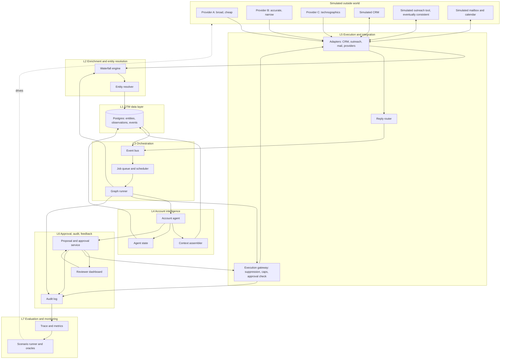
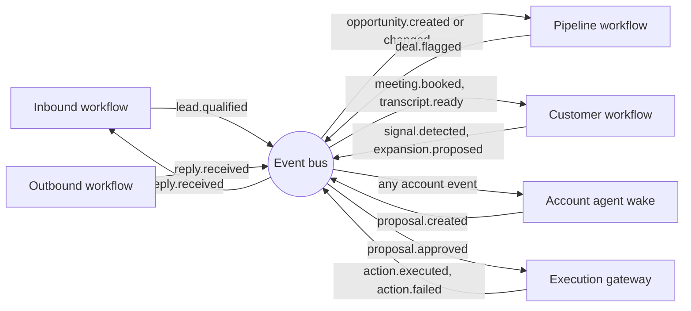
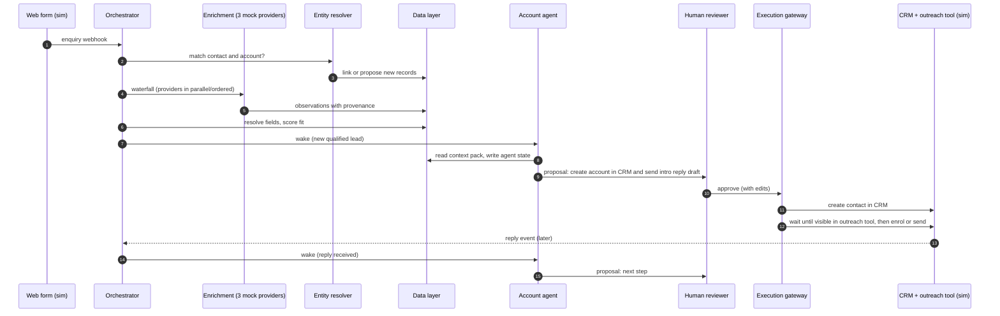
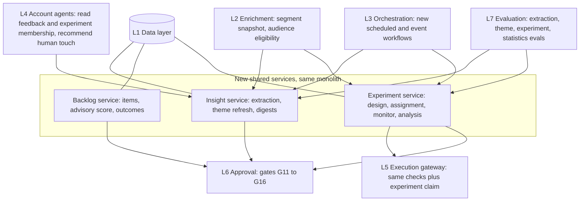

# Solution architecture

**Modified (Phase 3):** replaces the earlier stub. Evidence tags apply as elsewhere: **[F]** sourced, **[A]** assumption, **[P]** proposal. Almost everything below is **[P]**. The talk-derived concepts are explained in [gtm-engineering-framework.md](gtm-engineering-framework.md).

## 1. Principles carried forward

1. Four motions are **workflows on shared infrastructure**, not four agents.
2. Deterministic code by default; a language model only where input is unstructured; an agent loop only where the path depends on what is found ([problem-discovery.md](problem-discovery.md) section 4).
3. Safety by capability: no agent tool can send, quote a price or make an unreviewed CRM change.
4. Every consequential change flows Proposal, then human Decision, then deterministic Execution, with an audit event at each step.
5. Offline-reproducible: the whole system runs against simulators and recorded model responses.
6. No framework without a recorded reason.

## 2. Layered architecture

Seven shared layers, as requested, plus the simulated outside world.

| # | Layer | Responsibility | Key components |
|---|---|---|---|
| L1 | **GTM data layer** | Single source of truth for accounts, contacts, leads, opportunities, signals, interactions; provenance, confidence, freshness, field ownership | Postgres schemas, field-ownership policy, event store |
| L2 | **Enrichment and entity resolution** | Fill and verify data from several sources; decide which records are the same entity | Provider adapters, waterfall engine, survivorship rules, matcher |
| L3 | **Workflow orchestration** | Durable execution of graphs: triggers, waits, retries, parallelism, idempotency | Graph runner, job queue, scheduler, event bus (all Postgres-backed) |
| L4 | **Account intelligence** | Persistent per-account context and recommended next actions | Account state store, context assembler, account agent, change detector |
| L5 | **Execution and integration** | The only layer that touches outside systems; performs approved actions | Execution gateway, channel adapters, suppression and conflict rules, reply router, CRM sync |
| L6 | **Approval, audit, feedback** | Human decisions, immutable history, learning signal | Proposal and approval service, audit log, reviewer UI, feedback store |
| L7 | **Evaluation and monitoring** | Prove the system works and stays working | Scenario runner, ground-truth oracles, trace store, metrics, regression gates |

Reading the diagram: external systems are reached only through adapters, which live in L5 and are called by L2 (providers) and L3/L5 (others); internal notifications and the model-provider API are carved out of this rule but go through the same logged wrapper. Agents (L4) can read through the data layer and write only proposals and their own state. Approved proposals reach the outside world only via the execution gateway.

## 3. How the four workflows use the layers

| Layer | Inbound | Outbound | Pipeline | Customer |
|---|---|---|---|---|
| L1 Data | Creates lead; links or creates account/contact | Reads target accounts; records outreach activity | Reads opportunities and activities | Reads full account history; stores meetings and transcripts |
| L2 Enrichment and ER | Waterfall for the new lead's company and contact; duplicate resolution (critical path) | Waterfall for dossier inputs | Hygiene suggestions (missing fields) | Refresh stale stakeholder data before a meeting |
| L3 Orchestration | Webhook trigger, graph per enquiry | Batch graph with fan-out per account | Heartbeat schedule and CRM-change triggers | Calendar and transcript triggers |
| L4 Account intelligence | First wake creates account state and recommends next step | Dossier feeds state; agent proposes target priority | Main user: wakes on stall or change, explains risk, recommends action | Briefs built from state; signals update state |
| L5 Execution | Send approved reply; sync approved contact to outreach tool | Send approved message; suppression and conflict checks | Create task, apply approved field change | Send approved follow-up; apply approved CRM updates |
| L6 Approval and audit | Fit/route/reply approval | Account and message approval | Data fix, action and escalation approval | Follow-up, CRM change, expansion approval |
| L7 Evaluation | Qualification and ER evals | Draft factuality, suppression compliance | Detection precision/recall | Brief and summary quality |

## 4. Motion-to-motion interaction (event-driven)

The motions do not call each other. They emit and consume events on the shared bus, with the account record as the common context.

The account agent is the one place where all four motions' events converge, which gives the "coordinated system" rather than four chatbots.

## 5. Smallest end-to-end scenario (the "golden thread")

One flow that touches every layer. Chosen because it exercises the talk's four areas and our safety rules in the least code. Full milestone plan in [implementation-roadmap.md](implementation-roadmap.md).

*Note: the sequence above abbreviates the thread. Step 5 yields two linked proposals (CRM create of account, contact and opportunity; then the intro reply); steps 9 and 10 (day-45 stall heartbeat; audit and invariant check) are omitted for space and are in [implementation-roadmap.md](implementation-roadmap.md) section 2. Waiting is owned by orchestration and checks by the gateway ([orchestration.md](orchestration.md) section 13).*

## 6. Key architectural decisions

Full trade-off analysis in [technology-decisions.md](technology-decisions.md). Summary:

| ID | Decision | Rationale | Revisit when |
|---|---|---|---|
| AD-01 | Modular monolith (Python/FastAPI) plus a worker process plus simulators as separate small services | Fewest moving parts; simulators must be separable so integrations are exercised over real HTTP | Only if modules need independent scaling |
| AD-02 | Postgres is the only stateful dependency: entities, events, jobs, schedules, agent state | One transactional store lets a state change, event and audit record commit together | Event volume exceeds Postgres comfort |
| AD-03 | Small in-house durable graph runner, not a workflow framework | Needs: durable waits, idempotency, events in the same DB, offline replay. 11 node types | If the runner exceeds ~1,500 lines or needs distributed workers, adopt a framework |
| AD-04 | Account agents are event-driven "virtual agents": state in rows, wake on demand | Avoids a process per account; reproducible; cheap | Latency needs unmet |
| AD-05 | Claude Messages API with our own bounded tool loop | Control over budget, tracing, permissions and replay | Agent SDK spike shows clear net benefit |
| AD-06 | Field ownership policy enforced in the data layer | Prevents agents overwriting human or system fields regardless of prompts | n/a, core safety |
| AD-07 | Merges and external sends are proposals only | Destructive/outward actions need a human | n/a, core safety |
| AD-08 | n8n optional, edge-only (webhooks, notifications) | System must run without it | A reader wants a demo of n8n |
| AD-09 | Simulators have ground truth and fault injection | Makes provider accuracy, sync lag and reliability measurable | n/a |
| AD-10 | Two MCP servers split by risk (`gtm-read`, `gtm-propose`); no execution tool exposed to agents | Absence of capability is the control | n/a |

## 7. Security and permission model (summary)

| Principal | Can | Cannot |
|---|---|---|
| Agent (by profile) | Read within scoped account; write own state; create proposals; write agent-owned fields | Write human- or system-owned fields; call execution adapters; read other accounts' data |
| Deterministic workflow node | Read/write system-owned fields and observations; create proposals | Apply proposals; send |
| Execution gateway | Apply only proposals with a valid human approval | Create proposals; change content after approval |
| Human reviewer | Approve, edit, reject within role (BDR, AE, Director) | Edit audit log |
| Evaluation harness | Run everything against simulators | Touch production-like config |

Roles by gate type (who may approve what) are specified in [human-oversight.md](human-oversight.md).

## 8. Error handling summary

Per-node retries with backoff and jitter, timeouts, per-run budget caps, dead-letter to a "needs attention" queue, idempotency keys on every side effect, parking (not failing) when waiting on out-of-sync systems. Details and the CRM-to-outreach sync case are in [orchestration.md](orchestration.md) sections 5 to 7.

## 9. Integration of the GTM product loop (added after the second source)

The feedback, backlog and experiment capabilities ([gtm-product-loop.md](gtm-product-loop.md), [experimentation-engine.md](experimentation-engine.md)) add **no new layer and no new agent**. They are three shared services inside the modular monolith, built on the existing layers. Status per capability is in [maturity-and-scope.md](maturity-and-scope.md) section 3.

| Layer | What changes |
|---|---|
| L1 Data | New tables: feedback item, theme, theme link, lost-deal review, backlog item, handoff, ICP definition, experiment, variant, assignment, result snapshot, decision, learning ([data-model.md](data-model.md) section 10) |
| L2 Enrichment | Feedback items get a **segment snapshot** from resolved fields; experiment audiences are evaluated only over fresh resolved fields |
| L3 Orchestration | Six new workflows on existing node types ([orchestration.md](orchestration.md) section 10); no new node type |
| L4 Account intelligence | Context packs include the account's feedback items and experiment membership; wake trigger `feedback.captured`; new action `recommend_human_touch`; the agent cannot launch or alter experiments |
| L5 Execution | Experiments run through the same gateway; add experiment claim, holdout enforcement and guardrail auto-pause ([execution-architecture.md](execution-architecture.md) section 12) |
| L6 Approval | Gates G11 to G16 and a GTM Engineer role ([human-oversight.md](human-oversight.md) section 8) |
| L7 Evaluation | Extraction, theme, backlog-compliance and experiment-statistics evals; scenarios S31 to S44 ([evaluation-strategy.md](evaluation-strategy.md) section 8) |

Decisions added (details in [technology-decisions.md](technology-decisions.md) section 13): **AD-11** shared services, not agents; **AD-12** feedback items require a code-verified verbatim quote; **AD-13** experiments are configurations of existing workflows, and launch/expansion/stop-for-success are human-only; **AD-14** backlog priority is human-owned, scores are advisory; **AD-15** embeddings and statistics libraries deferred until justified.

## 10. Related documents

[data-model.md](data-model.md) · [orchestration.md](orchestration.md) · [account-agents.md](account-agents.md) · [execution-architecture.md](execution-architecture.md) · [technology-decisions.md](technology-decisions.md) · [agent-specifications.md](agent-specifications.md) · [mcp-integrations.md](mcp-integrations.md) · [human-oversight.md](human-oversight.md) · [evaluation-strategy.md](evaluation-strategy.md) · [gtm-product-loop.md](gtm-product-loop.md) · [experimentation-engine.md](experimentation-engine.md) · [maturity-and-scope.md](maturity-and-scope.md)
