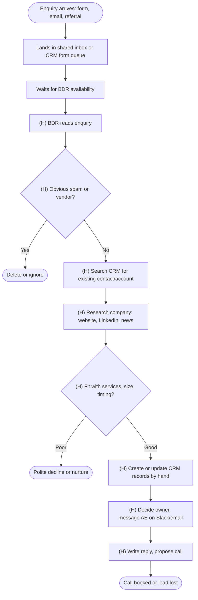
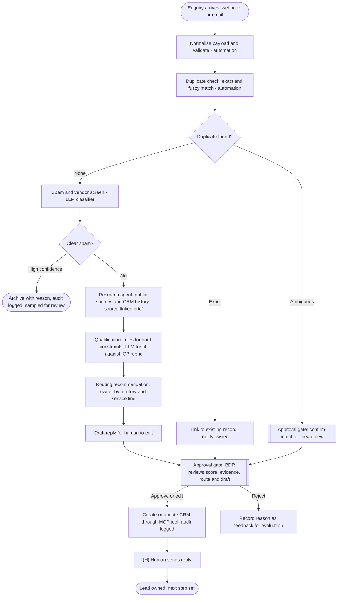
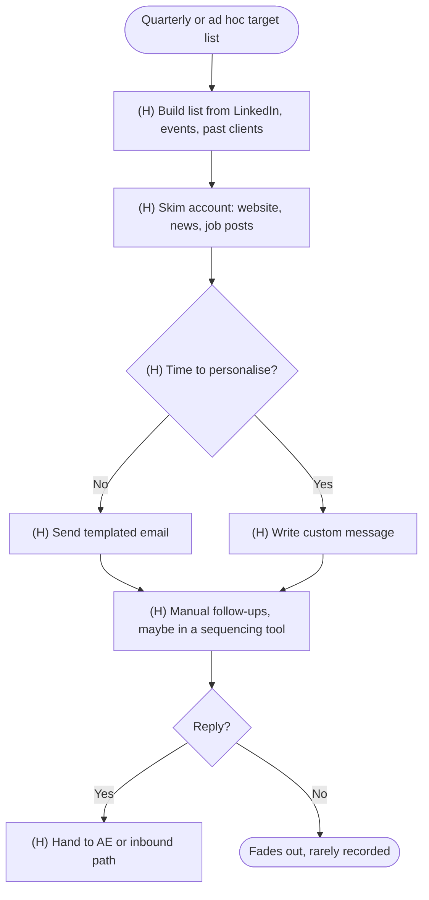
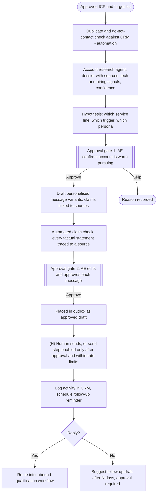
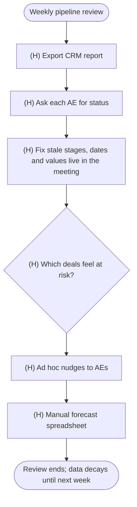
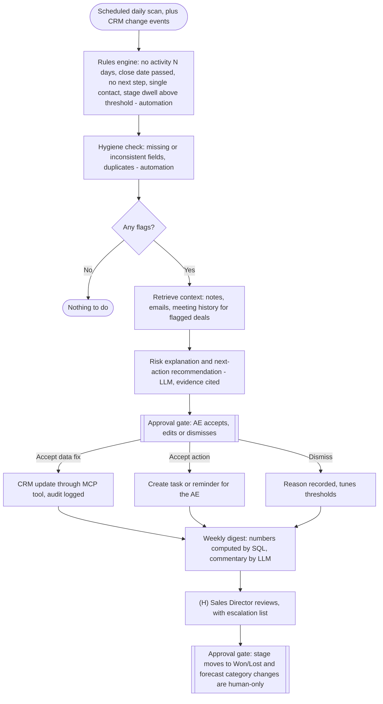
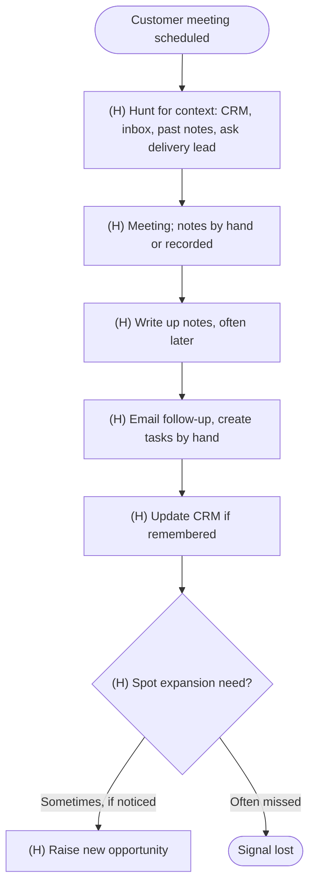
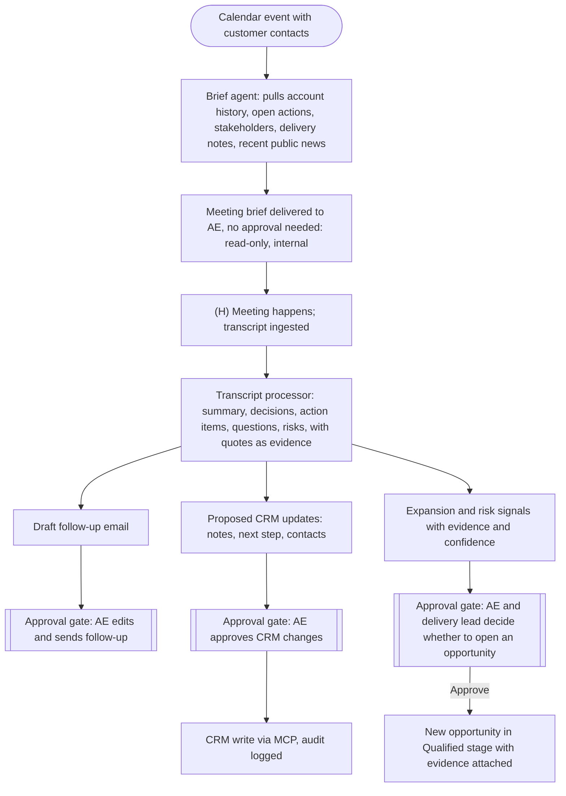
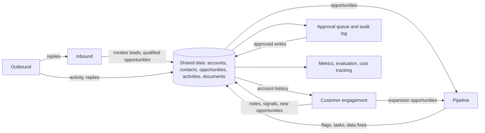
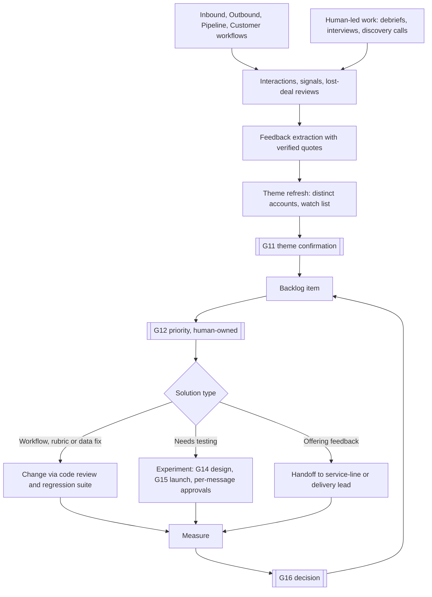

# Workflow analysis

AS-IS workflows are **[A]**: a typical manual process for a small consultancy, not an observed one. TO-BE workflows are **[P]**. Pain points reference the problem IDs in [problem-discovery.md](problem-discovery.md). Diagram conventions: rounded boxes are start/end, rectangles are steps, diamonds are decisions, and nodes marked **(H)** are human steps. In TO-BE diagrams, "Approval gate" nodes are mandatory human checkpoints.

## 1. Stakeholder analysis

| Stakeholder | Goals | Concerns about AI | Role in the system | Influence |
|---|---|---|---|---|
| Sales Director / Head of Growth | Predictable pipeline, accurate forecast, control of discounts | Loss of control; wrong numbers in forecasts | Approver for stage, value and escalation; consumer of digests | High |
| Account executives | Close deals, less admin | Spammy outreach harming relationships; being second-guessed | Approve outreach, accept or reject recommendations | High |
| BDRs | Hit meeting targets, clear queue | Being replaced; extra review work | Review qualification, handle edge cases | High |
| Solution architects | Valid scoping, fewer low-fit meetings | Wrong technical claims | Consume briefs; verify technical content | Medium |
| Delivery leads | Realistic commitments, protect capacity | Sales promising unavailable capacity | Consulted on expansion and capacity; never bypassed | Medium |
| RevOps / marketing ops | Clean data, working routing | Agents corrupting CRM; schema drift | Owns CRM schema, routing rules, permissions | High |
| Prospects and customers | Relevant, honest, timely contact | Spam, wrong facts, privacy | Indirectly affected | n/a |
| Legal / finance | No unapproved commitments, compliance | Unauthorised terms, data misuse | Sets policies the gates enforce | Medium |
| Executive sponsor | Measurable return, bounded risk | Cost, reputational incident | Receives metrics | High |
| (Case-study reader) | Credible engineering | Hand-waving, fake results | Evaluates this repository | n/a |

**Design implication [P]:** the highest-influence stakeholders worry about *loss of control* and *data corruption*, not about quality of prose. Approval gates, audit trails and CRM write safety get priority over output polish.

## 2. Motion 1: Inbound

### AS-IS

Pain points: wait time (P-01), repeated research (P-02), time spent on junk (P-03), duplicates created at "Search CRM" and "Create" (P-04), context dropped at routing (P-12).

### TO-BE

Automation versus AI: steps 1 to 2 are deterministic; spam screening and fit judgement are single LLM calls; research is the only agentic loop. The agent never sends the reply. A human sends it from their own client, or presses send on an approved draft.

## 3. Motion 2: Outbound

### AS-IS

Pain points: personalisation skipped under time pressure (P-05), little record of what was tried (P-13), reply handling inconsistent (P-12).

### TO-BE

Note **[P]**: In the case study, the "send" is a simulated outbox. Even in a production version, sending is a separate, permissioned action that the agents cannot invoke.

## 4. Motion 3: Pipeline management

### AS-IS

Pain points: stalled deals found late (P-06), review time spent on data repair (P-07), narrative assembled by hand (P-08), definitions inconsistent (P-13).

### TO-BE

Rule of thumb **[P]**: the numbers in the digest are computed by queries, never by the model. The LLM explains and recommends; it does not calculate.

## 5. Motion 4: Customer engagement

### AS-IS

Pain points: heavy preparation (P-09), late and incomplete follow-up (P-10), expansion signals missed (P-11), CRM stale (P-07).

### TO-BE

Meeting briefs are read-only and internal, so they carry no approval gate; everything that writes data or leaves the company is gated.

## 6. How the four motions connect (the "coordinated system")

The purpose is one shared record per account, not four chatbots **[P]**.

Concrete cross-motion handoffs:

| From | To | What flows | Why it matters |
|---|---|---|---|
| Outbound | Inbound | A reply to outreach enters qualification as a lead with the dossier attached | No re-research; consistent scoring |
| Inbound | Pipeline | Approved qualified lead becomes an opportunity with owner and source | Pipeline monitoring starts on day one |
| Pipeline | Customer | Deal at risk triggers a brief that highlights open issues | Meeting prep uses risk context |
| Customer | Pipeline | Approved expansion signal creates an opportunity | Closes the land-and-expand loop |
| All | Metrics | Every agent run records cost, latency and outcome | Business impact measured per motion |

## 7. Exception scenarios (carried into Phase 3)

| Scenario | Expected behaviour |
|---|---|
| Duplicate with conflicting data | Do not overwrite; raise match-confirmation gate |
| Research finds nothing reliable | Output "insufficient evidence"; route to human; never fabricate |
| Enquiry contains instructions aimed at the model | Treated as data; flagged in the audit log |
| CRM API failure or timeout | Retry with backoff, then park the run and alert; no partial writes |
| Approver never responds | Escalate after SLA; item expires safely without action |
| Approver edits a draft | Final human version is what is stored; diff retained for evaluation |
| Out-of-region or out-of-scope request | Recommend decline or referral; human decides |
| Transcript contains pricing talk | Summarise only; flag as commercial content; never propose terms |
| Same lead arrives twice within minutes | Idempotency key prevents double processing |
| LLM returns invalid structured output | Validate, retry once with the error, then fail safe to human review |

## 8. Phase 3 amendments (diagrams above unchanged)

*Added after incorporating the GTM Engineering talk. The TO-BE workflows above remain the intended business flows; Phase 3 changes how they are realised.*

| TO-BE element above | Phase 3 realisation |
|---|---|
| Inbound "Research agent: public sources and CRM history" | Split into a deterministic **enrichment waterfall** with provenance ([data-model.md](data-model.md) section 6) plus a bounded research agent only for facts the waterfall cannot supply |
| Inbound "Duplicate check" | Three-band entity resolution; merges are proposals ([data-model.md](data-model.md) section 5) |
| Pipeline "Scheduled daily scan" | Per-account **heartbeat** with a change detector ([account-agents.md](account-agents.md) section 5); rules still produce the stall flags |
| Pipeline/Customer "CRM update through MCP tool" | The agent creates a proposal; the **execution gateway** performs the approved write under field-ownership rules |
| Outbound "Human sends, or send step enabled only after approval and within rate limits" | Settled as: send is a human-initiated action performed by the gateway for the exact approved payload; sequences use just-in-time approval ([execution-architecture.md](execution-architecture.md) section 5) |
| Outbound "Reply: route into inbound" | Reply router with automatic suppression and sequence stops ([execution-architecture.md](execution-architecture.md) section 4) |
| Exception "CRM API failure or timeout: retry then park" | Extended with sync-lag waits and bounded polling ([orchestration.md](orchestration.md) section 7) |

New stakeholder consideration **[P]**: RevOps gains responsibility for the field-ownership policy and match/merge decisions, which raises its influence in the system.

## 9. Phase 3b: the learning loop as a fifth, cross-cutting workflow

The four motions are unchanged. A cross-cutting **learning loop** consumes what they produce. It is a set of shared-service workflows, not a fifth agent.

| Stakeholder | Role in the loop |
|---|---|
| GTM Engineer (new, central team) | Confirms themes, triages backlog, designs experiments, ships workflow changes |
| Director | Approves high-impact priority and experiment launch |
| AEs and BDRs | Source of feedback; enter lost-deal reasons; run debriefs |
| Service-line and delivery leads | Receive offering-level themes and respond |
| RevOps | Keeps taxonomy and ICP definition consistent |

AS-IS (**[A]**): lost reasons are a free-text CRM field, rarely filled; feedback is discussed in meetings and forgotten; improvement ideas are raised ad hoc; tests are informal. Pain points: P-16, P-17.
